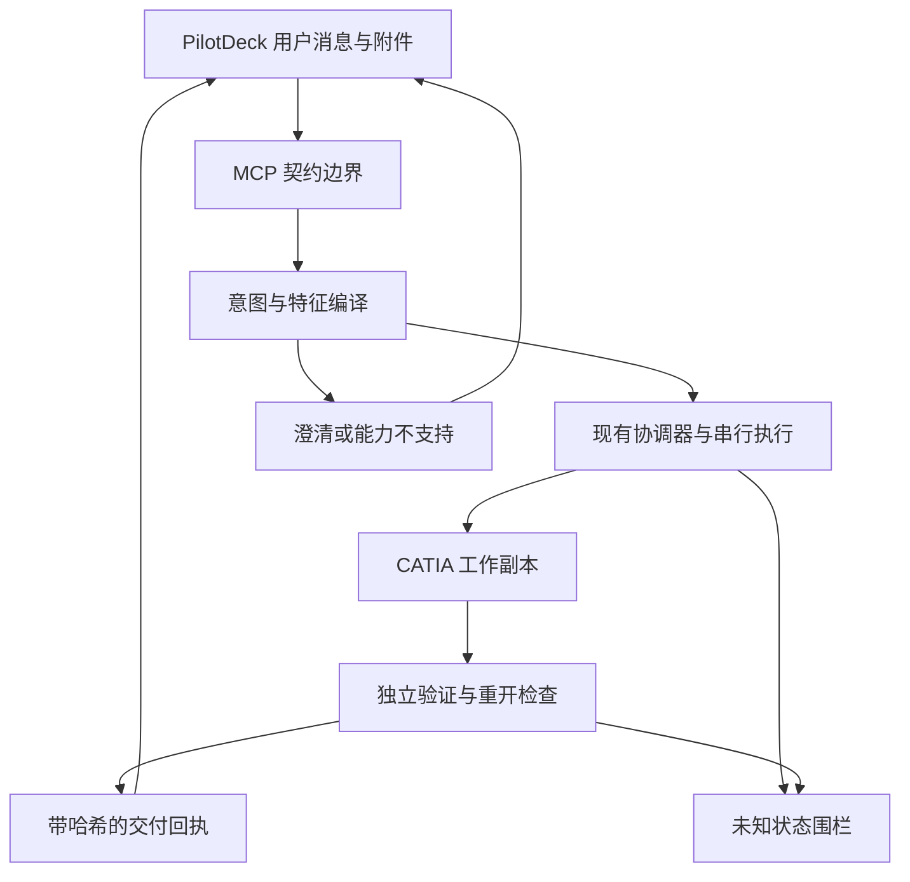
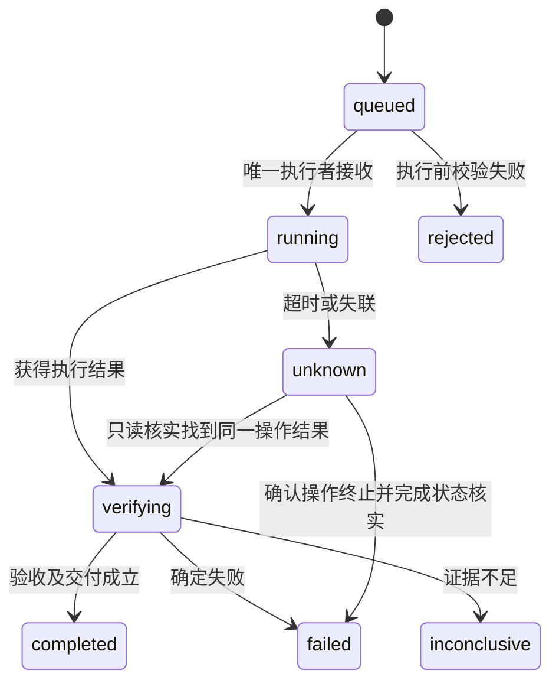
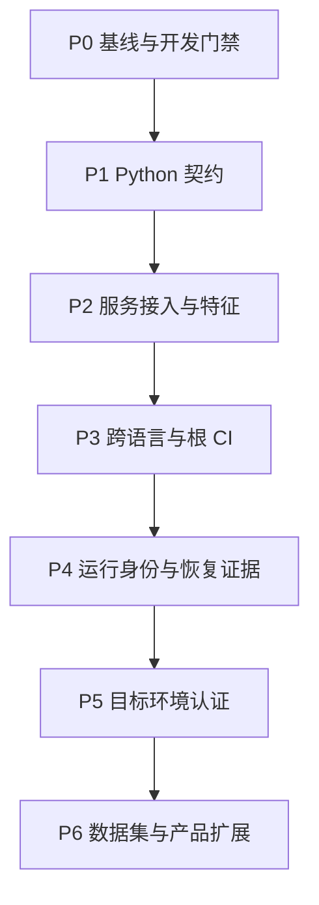

# CatiaAgent 无人值守架构演进与开发执行规划

版本 1.0　编写日期 2026年11月9日　适用对象 架构负责人、开发监督器、能力有限的编码 AI

本规划将现有 CatiaAgent 演进为契约一致、执行可恢复、结果可独立验收的 CAD Agent。实施顺序是先建立可信基线与开发门禁，再整理 Python 数据契约和 TypeScript 消费边界，随后补齐运行证据、恢复路径及实机认证。Pydantic v2 是契约层的实现工具，整体目标是让较弱的开发 AI 也能在明确边界内持续交付可验证的小改动。

适用仓库为 `BlueX888/CatiaAgent`，审查基线为 `b58e40bc0b8ad0152b4afc854757e6b4f4b094c9`。进入实际开发时，T00 必须重新确认工作区、版本和授权范围。任务清单全部初始为未执行；源码审查、历史报告、离线测试和真实 CATIA 验证是不同的证据等级。

## 1 目标与完成标准

### 1 1 本轮交付目标

本轮首先交付一条可受控演进的工程主线，覆盖自然语言改型与 PDF 参数化建模两条现有业务链路。每一项改动都必须回答三个问题：改变了哪个契约或行为，哪些原有行为保持兼容，用什么独立证据证明结果。

| 交付层次 | 完成标准 | 所需证据 |
|---|---|---|
| 开发基础 | 任务可恢复，依赖可判定，测试失败不会被标为完成 | 任务账本、测试门禁自测、断点恢复演练 |
| 契约改造 | 已迁移契约族有唯一结构定义；未迁移族有明确现有权威；Python 与 TypeScript 结构判定一致 | 冻结样本、Schema 版本、差分报告、跨语言测试 |
| 运行可靠性 | 关联身份、截止时间、执行状态与交付证据可追踪；未知状态保持围栏 | 故障注入、状态转换断言、恢复测试 |
| 产品认证 | 固定改型、PDF 建模及附件链路在指定 CATIA 环境下通过独立验收 | 本版本的交付件、重开测量、原件哈希、验收报告 |
| 扩展评测 | 数据、模型、工具与验收器冻结，逐案例如实报告 | 固定案例清单、环境清单、每次尝试记录 |

离线契约完成可以单独交付。真实 CATIA 环境不可用时，产品认证保持 `BLOCKED_ENV`；不得将离线完成写成产品已认证。Orla 全量目标和 NIST 扩展能力属于后续评测，不是每个契约小改动的验收前提。

### 1 2 本轮边界

主线保留 PilotDeck、低层 MCP Server、现有意图编译器、编辑协调器、特征构建器、COM 串行执行和独立验证器。先建立模块边界，不做大规模移动文件或重命名。只为已经识别的重复、兼容性缺口和可靠性问题增加组件。

以下工作单独进入后续路线：更换 Agent 框架，完整微服务拆分，装配与多实体，自由曲面及复杂钣金，知识图谱，面向客户的权限体系，三维预览，以及旧 Windows 与 Python 3.8 执行端。它们需要自己的业务输入、验收样本与环境证据，不能混入一次无人值守重构。

## 2 真实基线与现有规划的衔接

### 2 1 已确认的源码事实

| 项目 | 当前状态 | 对实施的影响 |
|---|---|---|
| MCP 参数入口 | `server.py` 使用低层 `mcp.server.Server`，手写 Schema 经 `jsonschema` 校验后执行 | 沿用路由与调用生命周期；不把 `validate_input=False` 误读成没有校验 [R01](https://github.com/BlueX888/CatiaAgent/blob/b58e40bc0b8ad0152b4afc854757e6b4f4b094c9/catia-v5-mcp-server/catia_mcp/server.py) |
| 编辑意图与计划 | 已有缺失信息澄清、单位换算、参数绑定、revision 与 oldValue 检查 | Pydantic 只接管明确的结构部分；保留语义和会话判断 [R02](https://github.com/BlueX888/CatiaAgent/blob/b58e40bc0b8ad0152b4afc854757e6b4f4b094c9/catia-v5-mcp-server/catia_mcp/editing/intent.py)[R03](https://github.com/BlueX888/CatiaAgent/blob/b58e40bc0b8ad0152b4afc854757e6b4f4b094c9/catia-v5-mcp-server/catia_mcp/editing/validation.py) |
| 图纸特征 | 手写 Schema、表达式语言、证据绑定、编译计划及执行前复核已经存在 | 禁止用一个模型替换完整领域验证 [R04](https://github.com/BlueX888/CatiaAgent/blob/b58e40bc0b8ad0152b4afc854757e6b4f4b094c9/catia-v5-mcp-server/catia_mcp/drawing/feature_schema.py)[R05](https://github.com/BlueX888/CatiaAgent/blob/b58e40bc0b8ad0152b4afc854757e6b4f4b094c9/catia-v5-mcp-server/catia_mcp/drawing/feature_model.py)[R06](https://github.com/BlueX888/CatiaAgent/blob/b58e40bc0b8ad0152b4afc854757e6b4f4b094c9/catia-v5-mcp-server/catia_mcp/drawing/feature_executor.py) |
| 结果状态 | Python 返回副作用与恢复字段；PilotDeck 有成功判定和未知状态围栏 | 保留三态 modified、失败传播、禁止自动重试等语义 [R07](https://github.com/BlueX888/CatiaAgent/blob/b58e40bc0b8ad0152b4afc854757e6b4f4b094c9/catia-v5-mcp-server/catia_mcp/results.py)[R08](https://github.com/BlueX888/CatiaAgent/blob/b58e40bc0b8ad0152b4afc854757e6b4f4b094c9/PilotDeck/src/tool/protocol/catiaFailureStatus.ts) |
| TypeScript Schema 检查 | 通用校验器只实现部分 JSON Schema 关键字 | 新契约使用完整验证器的独立适配入口，先验证再推广 [R09](https://github.com/BlueX888/CatiaAgent/blob/b58e40bc0b8ad0152b4afc854757e6b4f4b094c9/PilotDeck/src/tool/execution/validateToolInput.ts) |
| 参考几何证据 | `referenceGeometry` 在当前 requirements 代码中已实现，且有专用测试 | 旧计划中的新增任务改为回归与兼容性检查 [R10](https://github.com/BlueX888/CatiaAgent/blob/b58e40bc0b8ad0152b4afc854757e6b4f4b094c9/catia-v5-mcp-server/catia_mcp/drawing/requirements.py) |
| 依赖与运行环境 | Python 要求 3.10 及以上，pywin32 为直接依赖；PilotDeck 要求 Node 22 范围及 pnpm 10.32.1 | 固定解析后的版本；Linux 纯逻辑环境与 Windows 产品安装分开 [R11](https://github.com/BlueX888/CatiaAgent/blob/b58e40bc0b8ad0152b4afc854757e6b4f4b094c9/catia-v5-mcp-server/pyproject.toml)[R12](https://github.com/BlueX888/CatiaAgent/blob/b58e40bc0b8ad0152b4afc854757e6b4f4b094c9/PilotDeck/package.json) |
| 聚合仓库 CI | 递归 Git 树只发现组件内部 `.github/workflows`，根部无工作流 | 必须新增根目录接线，并确认真实 workflow run，而不是仅检查 YAML 文件 [R13](https://github.com/BlueX888/CatiaAgent/blob/b58e40bc0b8ad0152b4afc854757e6b4f4b094c9/catia-v5-mcp-server/.github/workflows/ci.yml)[R14](https://api.github.com/repos/BlueX888/CatiaAgent/git/trees/b58e40bc0b8ad0152b4afc854757e6b4f4b094c9?recursive=1) |

### 2 2 历史材料的使用规则

`docs/OrlaMechCAD-PilotDeck-无人值守开发计划.md` 已描述 Orla 数据集的无人值守流程。保留其中冻结输入、冻结容差、原生建模、独立验收、串行 CATIA 和有界修复等原则；将它作为数据集工作流，不重复创建第二套 Orla 跑批系统。[R15](https://github.com/BlueX888/CatiaAgent/blob/b58e40bc0b8ad0152b4afc854757e6b4f4b094c9/docs/OrlaMechCAD-PilotDeck-无人值守开发计划.md)

旧计划中的固定盘符、两个独立仓库、未提交修改、测试通过数量和模型配置属于当时环境。T00 必须建立当前环境映射，不能把历史机器布局当作现状。历史计划中要求权限绕过、仅靠提示词限制输出目录的做法不进入本轮执行协议；真实文件范围与可写工具由已有运行时机制强制约束。

迁移报告记载曾验证改型、PDF 建模和附件链路，同时列出运行注册、终态证据、UI 点击认证等缺口。先追踪当前代码，再补齐最小缺口，避免恢复整个旧平台子系统。历史成功记录不代替本版本验收。[R16](https://github.com/BlueX888/CatiaAgent/blob/b58e40bc0b8ad0152b4afc854757e6b4f4b094c9/PilotDeck/products/catia-agent/MIGRATION-REPORT.md)

NIST 材料中的读图完成与严格建模完成必须分别报告；Orla 14 例全通过是旧计划目标。本次 Git 快照没有包含完整 Orla 原始数据及历史运行附件，T00 应登记真实可用输入及哈希。缺失测试数据不允许由执行 AI 伪造后继续标记认证通过。[R15](https://github.com/BlueX888/CatiaAgent/blob/b58e40bc0b8ad0152b4afc854757e6b4f4b094c9/docs/OrlaMechCAD-PilotDeck-无人值守开发计划.md)[R17](https://github.com/BlueX888/CatiaAgent/blob/b58e40bc0b8ad0152b4afc854757e6b4f4b094c9/docs/实习收尾与交接.md)

### 2 3 文档与工作区约定

建议将本规划保存在聚合仓库的 `docs/CatiaAgent-unattended-architecture-plan.md`。PilotDeck 内长期维护的开发文档遵循 `AGENTS.md` 使用英文，优先更新既有模块说明。逐任务日志、探针和截图保存在忽略目录，不进入 PilotDeck 的受跟踪开发文档。[R18](https://github.com/BlueX888/CatiaAgent/blob/b58e40bc0b8ad0152b4afc854757e6b4f4b094c9/PilotDeck/AGENTS.md)

本规划中的新文件路径都是拟新增落点。若现有模块已承担同一职责，应在 T00 的路径映射中复用它；涉及公开契约或执行语义的路径替换须记入设计差异，不能悄悄扩大修改范围。

## 3 架构决策

### 3 1 五个职责层

| 层 | 主要职责 | 明确边界 |
|---|---|---|
| 产品与交互 | PilotDeck 接收用户消息、附件和会话，展示有证据的业务状态 | 不由模型总结决定建模成功 |
| 协议与契约 | MCP 输入输出、Python 模型、发布的 JSON Schema、TS 校验 | 校验结构与已声明的约束，不伪造缺失意图 |
| 领域编译 | 单位、尺寸语义、证据引用、作用域、依赖和可执行计划 | 不持有 COM 对象，不由 Schema 代替领域判断 |
| 执行与恢复 | 工作副本、锁、STA、journal、deadline、幂等检查和未知状态围栏 | 同一 CATIA 实例单写入者；失联不等于停止 |
| 验证与交付 | 独立读回、几何比较、可编辑性、保存重开、产物摘要 | 验证器依据冻结输入，不依据模型自报结论 |



运行证据贯穿五层，但不建立第二条绕过现有协调器的 CAD 调用通道。

### 3 2 决策清单

| 决策 | 本轮选择 | 选择依据及约束 |
|---|---|---|
| A01 平台边界 | 保持现有平台，做模块化增量改造 | 已有闭环与回归价值高，框架迁移不能直接解决契约漂移 |
| A02 结构定义 | 按契约族渐进采用 Pydantic v2 | 一个契约族只指定一个结构权威，双轨验证只用于迁移期 |
| A03 公开接口 | 保持既有 wire 字段、版本和错误语义 | 协议收紧是行为变化，必须由差异清单和语料验证 |
| A04 TypeScript 验证 | 为 CATIA 契约增加 Ajv 8 的 Draft 2020 12 适配器 | 不继续手工扩写一套完整 JSON Schema 引擎；不改变其他工具的默认行为 |
| A05 内部数据 | 纯数据模型与 COM 对象分离 | 模型可序列化；连接、锁和原生对象仍在执行层 |
| A06 状态恢复 | 复用 journal 和围栏，补充可持久化关联记录 | 不宣称任意副作用具有通用 exactly once 保证 |
| A07 证据标准 | PASS、FAIL、INCONCLUSIVE、NOT_VERIFIED 分开 | 体积和包围盒相近不能单独证明完整几何等价 |
| A08 开发控制 | 确定任务依赖、文件白名单、预算和机器门禁 | 执行 AI 负责完成小任务，不自行改变架构与验收标准 |

Pydantic 能生成 Draft 2020-12 Schema；Ajv 对该草案使用专用入口，不能把所有草案混在同一个实例中。本规划将公开契约、模型供应商适配 Schema、Python 语义验证分开管理。[D01](https://docs.pydantic.dev/latest/concepts/json_schema/)[D02](https://ajv.js.org/json-schema.html)

## 4 契约设计及迁移规则

### 4 1 契约族和唯一权威

| 契约族 | 建议模型 | 初期权威 | 迁移后权威 |
|---|---|---|---|
| 意图草稿 | 按 decision 区分的 Draft 模型 | 现有意图入口与协议 | Python 草稿结构模型加既有编译语义 |
| 编辑计划 | ParameterChange、Acceptance、EditPlan | 现有工具 Schema 与 validate_plan | 已验收的结构模型加原 validate_plan 的上下文判断 |
| 特征需求 | WireParameter、WireProfile、CanonicalFeatureRequirements | feature_schema 与现有解析器 | 完整 wire 结构模型加规范化适配与领域编译器 |
| 执行结果 | Effects、Recovery、分类型 Result payload | 当前结果封装与 TS 业务判断 | Python 结果模型加原业务状态检查 |
| 辅助进程结果 | EvaluationResult、InconclusiveSummary | feature_workflow 当前判断 | 结果结构模型加原数值和可信度判断 |
| host 运行上下文 | RunContext | 新契约定义 | 版本化纯数据模型与其发布 Schema |
| 本地运行证据 | EvidenceManifest | 现有报告加 sidecar | Python 版本化边文件，本轮不新增公开工具参数 |

每个跨语言契约族在注册表中记录 `contract_id`、wire 版本、结构源文件、生成器版本、生成摘要、验证模式和维护模块。模式只有 `legacy / shadow / active`：T09、T10、T12 安装的适配器默认 shadow，原入口仍决定生产行为，影子结果只进入隔离诊断。T16 建立并首次执行逐族推广流程；后续新增族必须在创建任务中重新完成同一组导出、差分与兼容门禁，并绑定当前源码及契约摘要后才能 active。T16 已完成不自动批准后来新增的 RunContext。尚未迁移的族继续使用旧入口。迁移族完成后，删除经等价测试证明重复的结构定义；领域判断不属于可删除重复项。

公开输入采用 Wire 模型描述完整接受集，内部 Canonical 模型描述归一化后的表示。决策别名、compact 数组和表达式 union 必须在 wire Schema 中显式表达；不能只在 before validator 中接受这些形式，再从 canonical 模型导出较窄的 Schema。原 wire dict 独立保留用于旧哈希；canonical 对象不得共享可变子对象并反向改写原输入。

### 4 2 保留缺失与未知

Draft 的 `needs_clarification`、`unsupported` 分支不强制具备计划分支的全部字段。`target.parameter`、单位、方向或证据缺失时保留“缺失”，交给既有澄清判断；不补造用户未提供的单位、坐标系或确认文字。host 注入的 `userText` 继续使用现有可信来源路径，模型字段不能替代。

执行计划要求完整的 session、revision、operationId、changes 等必要数据。参数真实存在、可写性、旧值匹配、保持条件和验收上下文继续交给现有验证函数。

结果模型中 `effects.modified` 是必填的 `true / false / null` 三态；`null` 保留不确定性。执行后输出校验失败时，不得包装成“输入无效且未修改”，应保留已知副作用或未知状态，禁止因此自动重新执行原操作。[R02](https://github.com/BlueX888/CatiaAgent/blob/b58e40bc0b8ad0152b4afc854757e6b4f4b094c9/catia-v5-mcp-server/catia_mcp/editing/intent.py)[R03](https://github.com/BlueX888/CatiaAgent/blob/b58e40bc0b8ad0152b4afc854757e6b4f4b094c9/catia-v5-mcp-server/catia_mcp/editing/validation.py)[R07](https://github.com/BlueX888/CatiaAgent/blob/b58e40bc0b8ad0152b4afc854757e6b4f4b094c9/catia-v5-mcp-server/catia_mcp/results.py)[R08](https://github.com/BlueX888/CatiaAgent/blob/b58e40bc0b8ad0152b4afc854757e6b4f4b094c9/PilotDeck/src/tool/protocol/catiaFailureStatus.ts)

### 4 3 严格校验不能破坏现有语言

针对纯数字命令字段，显式禁止布尔值冒充数值、非有限值及不受控的字符串强转。未知字段在已定义的封闭对象中拒绝；legacy wire 原先容许的扩展字段必须在兼容语料中列明，不能全局忽略，也不能无差别禁止。

图纸特征语言中的表达式字段保留数值或表达式的既有设计。例如零表达式字符串、命名参数、角度表达式与完整回转表示是协议的一部分，不能全部替换为 `StrictFloat`。表达式白名单、量纲、除零、证据引用和特征依赖仍调用现有函数。

Pydantic 默认会进行部分类型转换；采用 strict 的具体位置由字段契约决定。`extra="forbid"` 与 `allow_inf_nan=False` 不作为不加区分的全局替换。[D03](https://docs.pydantic.dev/latest/concepts/strict_mode/)[D04](https://docs.pydantic.dev/latest/api/config/)

wire 的 integer 字段沿用既有 JSON Schema 的数学整数语义：例如合法范围内的 `1.0` 可表示整数，但 `true` 和字符串 `"1"` 不能因此作为整数接受。Python 可以在显式规范化步骤得到 int，旧哈希仍使用原 wire 表示。将 `1 / 1.0 / true / "1"` 固定为跨语言样本，避免直接使用 StrictInt 造成 Python 与 JavaScript 的分歧。

### 4 4 三种哈希保持原样

现有编辑计划、普通建模计划和特征计划的 JSON 哈希规则不同。建立三组独立 golden 样本，记录原始字节与预期摘要。禁止统一 separators、Unicode 转义、默认值、数字表示、空值策略或 planId 排除方式。

第一阶段在边界解析后保留原 dict 进入原流程，避免将 `model_dump()` 直接替换进哈希链路。如果后续确需统一规范化，建立独立的新版本契约和迁移任务，不能在本轮维护提交中暗改。[R03](https://github.com/BlueX888/CatiaAgent/blob/b58e40bc0b8ad0152b4afc854757e6b4f4b094c9/catia-v5-mcp-server/catia_mcp/editing/validation.py)[R05](https://github.com/BlueX888/CatiaAgent/blob/b58e40bc0b8ad0152b4afc854757e6b4f4b094c9/catia-v5-mcp-server/catia_mcp/drawing/feature_model.py)[R19](https://github.com/BlueX888/CatiaAgent/blob/b58e40bc0b8ad0152b4afc854757e6b4f4b094c9/catia-v5-mcp-server/catia_mcp/drawing/plan.py)

### 4 5 Schema 发布和消费

新增结构模型首先用于内部与影子差分。通过冻结语料后，从 Wire 模型生成完整工具参数 Schema，确保 `$defs` 在正确根位置、所有 `$ref` 可解析。禁止把带根引用的子 Schema 直接塞进 `properties.requirements` 后假定仍然有效。

公开 JSON Schema 是完整契约；模型供应商需要的转换版本是派生表示，其简化不降低服务端验证。Pydantic 的 Python 自定义验证器不自动变成完整 Schema 规则，因此跨语言语料应分别标记结构判定、领域判定和副作用断言，不要求 Ajv 实现 Python 的全部领域逻辑。

TypeScript 适配器固定使用 Draft 2020-12，关闭类型转换、默认值填充和额外字段删除，开启有限数值检查。Schema 在启动时编译并缓存。不得自动联网解析任意引用，只允许打包注册的契约。Pydantic 可能生成的 `discriminator.mapping` 不能直接依赖 Ajv 的 discriminator 扩展；保留完整 oneOf/const 断言，若移除 discriminator 注释，应由专门转换函数和等价样本证明，不关闭全局严格检查来掩盖问题。[D01](https://docs.pydantic.dev/latest/concepts/json_schema/)[D02](https://ajv.js.org/json-schema.html)[D05](https://ajv.js.org/options.html)

生成产物存入根部 `contracts/catia/v1/`；TS 打包副本是 `PilotDeck/src/tool/protocol/generated/catiaContracts.ts`，由生成器产生，不手改。Python 运行时通过包内模型和 `contracts.export` 生成 Schema，不依赖根部静态 JSON。服务运行时不读取仓库外的兄弟目录。T13 构建 wheel，解包到独立临时目录并离开仓库加载 Schema，验证代码和依赖声明；Windows G3 再验证正常依赖安装，不使用 Linux 的不完整安装冒充支持。

客户端路由固定如下：注册表 active 且版本与允许的有效 Schema 摘要匹配，使用 Ajv；明确登记为 legacy 的工具沿原路径；shadow 工具运行差分但仍保持原决策；已知契约的不支持版本、缺失必需标识或未知摘要拒绝，不降级到宽松路径。非 CATIA 工具行为不变。普通模式与 generation mode 的有效 Schema 分别登记和验证，服务端动态限制始终权威；host 不得以较宽松的本地基础 Schema 声称已经验证有效策略。

### 4 6 异常映射和动态策略

`server.py` 当前已经导入 jsonschema 的 `ValidationError`。引入 Pydantic 时使用明确别名，避免破坏现有 `argument_error()` 对 `.context`、`.validator` 等信息的处理。

结构错误在连接 CATIA 或执行工具之前返回既有 `INVALID_ARGUMENT` 或对应边界错误。保持既有业务错误码与 `code / message / path` 形状，不要求跨库英文错误文本字节一致。中文说明可展示，但机器判断依靠错误码和字段路径。

active 结果验证失败使用独立的最小失败回执构造器，不再次调用同一个出错的结果工厂。回执保留工具、operation ID、原诊断以及能确认的副作用，返回有效失败状态且不重放 COM。shadow 阶段仅记录差异，不能偷偷改变原输出路径的决策。

generation mode 动态强化的 `evidencePath`、`requireEvidence`、`editCheck`、禁止覆盖 expected 等规则继续在有效策略层生效。静态 Schema 导出不能替换会话、文件身份和运行模式策略。[R01](https://github.com/BlueX888/CatiaAgent/blob/b58e40bc0b8ad0152b4afc854757e6b4f4b094c9/catia-v5-mcp-server/catia_mcp/server.py)

## 5 运行可靠性和证据

### 5 1 开发任务与产品运行分开

开发任务使用 `task_id`，记录代码修改、测试和检查点；产品运行使用 `run_id / attempt_id / operation_id`，记录用户输入、CAD 状态和交付。二者可关联，不共享状态机。开发任务失败可以重试代码修复，不能据此自动重放一笔结果未知的 CAD 写入。

新增 RunContext 至少包含运行 ID、尝试 ID、源快照摘要、实际代码版本、契约版本、模型与提示词标识、工作目录、现有会话关联和可选截止时间。身份字段由 host 生成或绑定，模型不得自由填写来授权文件访问。运行记录引用现有 journal 和平台会话，不建立第二份“谁有权写 CATIA”的权威。

### 5 2 状态与恢复



此图是观测状态，不改变原编辑协调器内部状态机。`unknown` 不自动回到 queued。重连成功、客户端超时、心跳过期、创建新会话都不证明旧写操作已停止。读取状态和恢复只能沿既有协调器、journal 与围栏机制执行。

deadline 的生产者位于 host；deadline 只能限制执行，不赋予操作权限。执行前过期必须零写入；执行中到期不声称事务被取消。传输取消、代码任务超时和 CAD 的真实终止分别记录。

### 5 3 独立证据

每次认证绑定代码提交及补丁摘要、契约摘要、输入文件哈希、期望值及容差摘要、环境版本、运行 ID、执行结果、交付件及报告哈希。验证器从磁盘重开交付件，使用事前冻结的期望，而不是从待验模型反向生成期望。

本轮 EvidenceManifest 写为原报告旁的版本化 sidecar，沿现有报告位置关联，不修改旧计划哈希或新增未注册的公开回执字段。界面使用已有且经校验的 verification、delivery 和 effects 等业务状态；若以后需要把完整 sidecar 作为新工具输出提供给客户端，按新契约族另行导出和验证。

结果分为 `PASS / FAIL / INCONCLUSIVE / NOT_VERIFIED`。结构合法、工具返回成功、模型回合 completed、文件存在和几何验收通过分别记录。原生参数化特征、可编辑性、原件未改动、保存重开、材料或几何检查均按业务样例明确要求。

体积或包围盒变化可以支持“修改产生了可测影响”，不自动支持“整体几何等价”。不得为了提高通过率把不确定比较改写成成功，也不得在看到结果之后放宽容差。[R20](https://github.com/BlueX888/CatiaAgent/blob/b58e40bc0b8ad0152b4afc854757e6b4f4b094c9/catia-v5-mcp-server/catia_mcp/drawing/feature_workflow.py)

## 6 无人值守开发协议

### 6 1 开始工作

执行器先读取本规划的第 1 至 8 节、`tasks.json` 和已有执行状态，再根据依赖选择任务。`PLAN_ROOT` 是本规划包所在目录，`REPO_ROOT` 是 T00 确认的源码根，`RUN_ROOT` 是本次证据目录；三者不得混淆。任务中的 tasks.json 和模板从 PLAN_ROOT 读取，业务源码路径相对 REPO_ROOT，RUN_ROOT 路径保存执行产物。T00 未完成前只允许发现与记录，不修改业务代码。当前工作区存在用户修改时保留其内容，优先在独立 worktree 或隔离副本内工作；不能用 reset、clean 或覆盖恢复成“干净”。

运行目录建议为聚合仓库外的 `work_root/catiaagent-architecture/<run_id>/`，或经确认已忽略的 `artifacts/architecture/<run_id>/`。根路径必须从实际环境取得，不硬编码历史盘符。稳定任务定义可提交，执行账本和日志存于运行目录。

实际代码写入、提交、推送、真实 CAD 操作和发布以执行会话已有授权为准。文档本身不创建调度、不启动开发、不改变权限。已授权的可逆开发任务连续推进，无须每个任务重复确认。

### 6 2 单任务工作循环

1. 检查任务依赖全部 `DONE`，确认任务文件范围和需要的环境。
2. 读取任务列出的代码、最近模块说明、相关测试及既有协议；写出本次一个明确的行为变化。
3. 运行相关基线门禁。受影响基线为红时先分类，不覆盖原报告。
4. 只在白名单内实施。默认最多改动 4 个生产文件；需要更多时拆出子任务并保持同一交付目标，不自行扩大范围。
5. 运行新增的行为断言与既有相关回归。测试应证明可观察行为，不仅重复实现细节。
6. 用门禁包装器读取命令退出码、测试收集、失败和跳过情况，产生机器结果；AI 的“看起来没问题”不是完成条件。
7. 保存 diff、源码指纹、命令日志、结构化报告和下一任务；只有全部验收成立才标 `DONE`。

每个任务最多 1 次初次实施及 2 次针对同一失败的修复。超出预算写入阻塞原因。单次执行任务建议预算 45 分钟；到预算时做检查点，不通过压缩验收或危险终止 CAD 来满足时间上限。纯基础设施重试最多 2 次且有截止时间，不重复提交带副作用操作。若任务卡列出多于 4 个生产落点，按其步骤拆成有序子检查点；每次只实施并验证一个子检查点，父任务全部完成后才解锁下游。

T00 至 T03 是引导阶段，允许直接运行已经存在的命令，人工式读取退出码与测试机器报告并按同一结果模板保存，不依赖尚未创建的包装器。T03 完成后用包装器重新核对引导期报告的适用范围；后续任务必须通过包装器，不能假造其命令。

### 6 3 状态定义

| 状态 | 含义 | 后续动作 |
|---|---|---|
| PENDING | 依赖未满足或尚未选择 | 等待，不执行 |
| READY | 依赖完成且环境满足 | 可领取 |
| RUNNING | 单一执行者持有任务 | 其他执行者不可重复领取 |
| VERIFYING | 实施完成，验证进行中 | 不得跳过验证直接完成 |
| DONE | 必需验收全部通过且证据落盘 | 解锁依赖任务 |
| BLOCKED_ENV | 缺平台、依赖、许可证或数据 | 继续无依赖的其他任务 |
| BLOCKED_BASELINE | 原有相关门禁失败且未获得修复范围 | 保存差异，不伪造绿色基线 |
| BLOCKED_CONTRACT | 必须改变公开语义或违反架构决定 | 形成具体决策包，等待决策 |
| FAILED | 修复预算耗尽或验收明确失败 | 不解锁下游 |

恢复时，先核对当前源码指纹与最近成功任务一致，再查看 RUNNING 的原执行者是否仍在工作。只接管确认停止的开发任务；无法确认的 CAD 状态继续保持围栏。依赖关系以 `tasks.json` 为准，不能通过修改账本把阻塞任务伪装为 DONE。

### 6 4 并行范围

最多并行 2 个互不依赖、修改文件不重叠的代码任务，各自使用独立工作区。依赖文件、锁文件、Schema 生成物和 CI 的集成串行进行。CATIA 每实例只允许一个真实写任务；锁不使用客户端超时直接回收。新任务不并行修改 `server.py`、`coordinator.py` 或同一契约族。

### 6 5 必须生成的任务结果

任务结果含任务 ID、计划版本、基线 SHA、补丁及最终工作树指纹、环境摘要、改动文件、命令及 cwd、退出码、报告路径、测试 collected/passed/failed/skipped/xfailed、跳过原因、门禁判定、剩余风险和下一任务。若代码未提交，使用基线 SHA 加二进制安全 diff 与新增文件内容摘要标识，不能只写 HEAD。

总状态文件使用临时文件写入后原子替换；追加事件记录具有单调序号。保留最近成功检查点和失败现场。日志只记录已批准的测试输入和必要错误，不收集完整环境变量或模型密钥。

## 7 门禁和命令目录

### 7 1 门禁分层

| 门禁 | 环境 | 主要证明 | 阻塞条件 |
|---|---|---|---|
| G0 | 当前开发环境 | 基线、依赖、工作区和任务范围可复现 | 无法确认版本、工作区冲突、所需依赖不可得 |
| G1 | Linux 或 Windows 的纯逻辑环境 | Python 契约、编译和错误映射 | 必跑测试未收集、跳过或失败 |
| G2 | Node 22 与 pnpm | TS Schema、MCP 结果及供应商适配兼容 | 构建失败、结构语料分歧、状态误判 |
| G3 | Windows Python 3.10 和 3.12 | 产品平台完整离线回归 | pywin32 或平台行为缺失、基线回归 |
| G4 | 独立 CAD support Python 环境 | 几何辅助比较和 STEP 相关验证 | cadgen/build123d 缺失、必需 STEP 数据缺失 |
| G5 | 专用 Windows 与真实 CATIA | 原生执行、保存重开、独立验收及故障属性 | 环境/许可证/固定夹具缺失，或正常成功样例的结果未知 |
| G6 | 已冻结版本与验收清单 | 同一版本整体交付与证据完整 | 必需门禁缺失、报告版本不一致 |

G1 和 G2 是离线交付门槛；影响 Windows 执行服务的生产集成还需要 G3。修改计划语义、表达式、几何执行、成功判定或恢复行为时，产品认证必须完成相应 G4/G5。纯文档调整只检查引用和内容，不强制启动所有环境。

G5 区分测试判定与被测业务结果。故障场景事前要求保留 unknown／INCONCLUSIVE 时，围栏、状态和副作用次数符合预期即可使该故障测试 PASS；这不把被测操作计为成功交付。正常交付样例仍要求业务验证 PASS。认证报告必须分别记录这两个维度。

### 7 2 现有命令

下表的命令来自当前仓库入口。实际依赖版本由 T00/T01 冻结；命令可用性与执行结果须在目标环境确认。运行前由包装器创建独立产物目录并清除非本次测试的运行绑定配置，不能继承生产 CATIA_* 状态。

| 命令 ID | 工作目录 | 命令或参数 |
|---|---|---|
| C01 | 仓库根 | `git status --short` 和 `git rev-parse HEAD` 分别执行；对子目录确认真实 Git 根 |
| C02 | catia-v5-mcp-server | 源码离线环境安装 pytest、mcp、jsonschema、PyMuPDF 的锁定版本；迁移后追加锁定的 Pydantic v2 |
| C03 | catia-v5-mcp-server | `python -m pytest tests/test_server_runtime.py tests/test_editing_offline.py tests/test_feature_model.py tests/test_feature_workflow.py -q -ra --junitxml=artifacts/architecture-g1.xml` |
| C04 | PilotDeck | `pnpm install --frozen-lockfile --filter pilotdeck --filter pilotdeck-ui` |
| C05 | PilotDeck | `pnpm run build` |
| C06 | PilotDeck | `node --test --test-timeout 60000 --test-reporter=tap dist/tests/tool/protocol/catia-failure-status.spec.js dist/tests/mcp/catia-build-failure.spec.js dist/tests/mcp/client/catia-session-fence.spec.js dist/tests/mcp/stdio-roundtrip.spec.js dist/tests/model/request/openaiSchema.spec.js` |
| C07 | catia-v5-mcp-server | Windows 中 `python -m pip install -e ".[dev]"` |
| C08 | catia-v5-mcp-server | Windows 中 `python -m pytest tests test_server.py -q -ra --junitxml=artifacts/architecture-g3.xml` |
| C09 | PilotDeck | UI 改动时 `pnpm --dir ui exec vitest run --project client`，并按受影响 UI server 行为追加 server 项目测试 |
| C10 | catia-v5-mcp-server | `python scripts/independent_verify_part.py <已存在且已冻结的规范文件> --out <本次独立报告>` |

C02 的基础版本范围来自 pyproject，不在 Linux 安装带无条件 pywin32 的完整发行包。冻结文件记录实际解析版本、平台和来源；后续执行不重新选择 latest。C04 对新增 Ajv 依赖的任务允许一次有范围的锁文件更新，之后恢复 frozen-lockfile 验证。C05 包含现有构建前置步骤，不能删掉 prebuild 来减少错误。

PilotDeck 这些协议测试使用 Node 原生测试运行器，不用 Vitest 代替。每项任务的 `test_runs` 固定 runner、环境、cwd、argv、报告格式与路径；新测试不能只创建而不执行。C10 中尖括号是说明位置，不得原样执行；T26/T27 必须先产生真实规范与文件，再登记完全解析的 argv。[R12](https://github.com/BlueX888/CatiaAgent/blob/b58e40bc0b8ad0152b4afc854757e6b4f4b094c9/PilotDeck/package.json)[R21](https://github.com/BlueX888/CatiaAgent/blob/b58e40bc0b8ad0152b4afc854757e6b4f4b094c9/catia-v5-mcp-server/scripts/independent_verify_part.py)

`{REPO_ROOT}`、`{RUN_ROOT}` 和解释器变量由 T00/T01 的登记值机械展开，禁用 shell 替换。Python 使用 pytest JUnit；编译后的 Node 测试使用 TAP 并由包装器保存 stdout；UI 使用指定 Vitest client 项目的 JSON 报告。根脚本测试在仓库根运行。所有报告路径在执行前创建，不能复用旧报告；需要 build 的条目先运行 C05。C03/C08 中示例报告路径也由包装器替换为本次运行的唯一绝对路径。

### 7 3 门禁包装器的新增职责

T03 新增包装器，采用 argv 数组和显式 cwd 执行命令，不拼接带用户输入的 shell。每次运行使用唯一输出目录，记录命令与源码指纹。支持 tasks.json 登记的 JUnit、TAP、Vitest JSON 以及 wheel 检查格式；未知报告格式不得推测成功。未来入口可预先登记为未创建，只有被请求执行时才检查其存在；不能因后续脚本未生成而阻塞 T03 自身。

退出码 0、必跑测试确实收集执行、所有必须断言满足、无未批准跳过，四项同时成立才输出 PASS。`xfail` 只作为登记的基线信息，不算对该行为的成功证明。新出现或消失的测试 ID、异常归零的收集数都需要失败或阻塞判定。

基线原有失败只能按预先登记的 test ID、原因和环境限定排除在某次窄范围任务之外；正式产品发布不能用未验收的相关失败兑换通过。禁止删除失败断言、批量更新 golden、降低容差、添加任意 skip/xfail 或缩小 mandatory 清单来解除门禁。

## 8 实施阶段与依赖

| 阶段 | 任务 | 阶段出口 |
|---|---|---|
| P0 基线与监督 | T00 至 T03 | 环境与基线可信，语料冻结，任务门禁可运行 |
| P1 Python 契约 | T04 至 T08 | 小结构、计划、结果及辅助响应模型可离线验证 |
| P2 服务接入与特征 | T09 至 T13 | 保留执行语义的适配器与完整 Schema 导出 |
| P3 跨语言与 CI | T14 至 T18 | TS 同源结构验证、供应商适配、差分门禁、独立离线交付及根 CI |
| P4 可恢复产品运行 | T19 至 T24 | 关联记录、deadline、围栏恢复与有证据的状态展示 |
| P5 目标环境认证 | T25 至 T29 | Windows 与固定真实业务样例的独立认证及最终证据包 |
| P6 有条件扩展 | T30 至 T32 | 数据集接线与最小产品改进；独立报告，不伪装核心已完成 |



先完成代码中的小边界；不将“达到某个数据集通过率”作为促使执行 AI 无止境扩大任务的理由。新增业务能力通过新任务卡立项，不篡改本轮完成定义。

## 9 可执行任务卡

任务 ID、依赖及验收要求与随附 `tasks.json` 一致。`RUN_ROOT` 是 T00 解析出的运行目录；下列 `scripts/architecture`、`contracts` 和 `catia_mcp/contracts` 中的新文件均为计划产物，不代表仓库已经存在。新增测试文件必须先由所属任务创建，再由 G1/G2 包装器以明确路径运行。

### T00 建立真实仓库和环境清单

**阶段** P0　**依赖** 无　**环境** `offline`　**范围** 主线

**先读** `README.md`；`项目需求.md`；`PilotDeck/AGENTS.md`；`PilotDeck/CONTRIBUTING.md`；`PilotDeck/src/README.md`；`catia-v5-mcp-server/pyproject.toml`；`docs/OrlaMechCAD-PilotDeck-无人值守开发计划.md`。

**允许写入** `RUN_ROOT/environment.json`；`RUN_ROOT/repository-map.json`；`RUN_ROOT/execution_state.json`。

**实施步骤**

1. 分别确认聚合根和两个组件的实际 Git 根、HEAD、分支及已有修改，保存不含密钥的环境摘要。
2. 登记 Python、Node、pnpm、CATIA、CAD support、模型连接与测试件是否真实可用；只读探测，不自动启动 CAD 写操作。
3. 将历史盘符映射为实际工作路径，确定隔离工作区、运行目录及执行会话的操作范围。
4. 记录旧文档与源码差异，确认 referenceGeometry 已存在、根 CI 待接线，缺失资源标记 unavailable。

**验收**

- 清单有实际 SHA、工作区指纹和修改清单；用户文件未变化。
- 所有后续路径都能从 repository-map 解析；未获得的环境值是 null 并附原因。

**门禁** G0。现有命令 C01。

**停止条件** 无法确定真实仓库或隔离会覆盖用户修改。；将旧文档路径、旧通过数量当作本机事实。

### T01 运行并冻结各环境的原始基线

**阶段** P0　**依赖** T00　**环境** `offline`　**范围** 主线

**先读** `catia-v5-mcp-server/tests/conftest.py`；`catia-v5-mcp-server/.github/workflows/ci.yml`；`PilotDeck/package.json`；`PilotDeck/ui/vite.config.js`。

**允许写入** `RUN_ROOT/baseline/**`；`RUN_ROOT/constraints/**`；`RUN_ROOT/gate-baseline.json`。

**实施步骤**

1. 在独立环境解析依赖并记录完整版本，保留现有锁文件；不将 Linux 源码测试冒充完整产品安装。
2. 运行当前可用的 C03 和 C04 至 C06；Windows 可用时运行 C07/C08。
3. 逐个记录收集、通过、失败、跳过和预期失败的 test ID；必需环境缺失单独登记。
4. 给每个基线失败记录是否影响本轮契约范围；不修改生产代码来制造基线。

**验收**

- 每条基线绑定命令、cwd、环境、源码指纹和原始报告。
- 基线发现任务可以 DONE，但不可用门禁仍为 BLOCKED_ENV，不被写成 PASS。

**门禁** G0。现有命令 C03, C04, C05, C06, C07, C08。

**停止条件** 相关基线失败原因不清，后续生产修改须等待分类。

### T02 冻结契约语料和三类计划哈希

**阶段** P0　**依赖** T01　**环境** `offline`　**范围** 主线

**先读** `catia-v5-mcp-server/catia_mcp/editing/validation.py`；`catia-v5-mcp-server/catia_mcp/drawing/plan.py`；`catia-v5-mcp-server/catia_mcp/drawing/feature_model.py`；`catia-v5-mcp-server/tests/test_feature_model.py`；`PilotDeck/src/tool/protocol/catiaFailureStatus.ts`。

**允许写入** `contracts/catia/v1/fixtures/**`；`contracts/catia/v1/corpus-index.json`；`catia-v5-mcp-server/tests/test_contract_baseline.py`。

**实施步骤**

1. 用现有测试和原实现建立第 10 节语料，每条写明 oracle 来源及结构/领域/副作用预期。
2. 为编辑计划、普通 build plan 和 feature plan 分别固定原始 JSON 字节及摘要。
3. 收录合法表达式、澄清别名、unknown 结果、text 与 structuredContent 不一致等负例。

**验收**

- 不改生产逻辑即可验证基线语料；语料没有密钥和客户文件。
- 必需情形全部在索引出现，禁止用新模型自动重录 oracle。

**门禁** G1。现有命令 C03。

**新增或追加测试** `catia-v5-mcp-server/tests/test_contract_baseline.py`。

**停止条件** 公开契约、哈希或原有领域语义出现未批准变化。

### T03 实现开发门禁和可恢复任务账本

**阶段** P0　**依赖** T01　**环境** `offline`　**范围** 主线

**先读** `tasks.json`；`execution_state.template.json`；`task-result.template.json`。

**允许写入** `scripts/architecture/gate.py`；`scripts/architecture/task_state.py`；`scripts/architecture/command_profiles.json`；`scripts/architecture/tests/test_gate.py`；`scripts/architecture/tests/test_task_state.py`。

**实施步骤**

1. 按 argv 数组运行固定命令，并机械执行任务 test_runs 的 runner、cwd、argv 与报告映射；不临时猜测测试运行器。产物目录由 RUN_ROOT 分配。
2. 实现依赖检查、单任务领取、原子状态更新、源码指纹绑定和中断后恢复，不加入云调度服务。
3. 用合成报告演练零收集、必跑 skip、报告缺失、版本不一致及预算耗尽。
4. 命令登记表区分现有入口与本任务以后创建的入口，未存在的命令直接阻塞。

**验收**

- 零收集、缺报告、必跑 skip 和非零退出码均不能产生 PASS。
- 两个执行者无法同时领取同一任务；旧源码报告不能认证新修改。
- 监督器从不自动重放 CAD 操作。

**门禁** G0。由 T03 按本任务明确断言登记命令。

**新增或追加测试** `scripts/architecture/tests/test_gate.py`；`scripts/architecture/tests/test_task_state.py`。

**停止条件** 实现依赖修改产品 CAD 状态机或另建远程任务平台。

### T04 建立纯 Python 契约模块与依赖

**阶段** P1　**依赖** T02, T03　**环境** `offline`　**范围** 主线

**先读** `catia-v5-mcp-server/pyproject.toml`；`catia-v5-mcp-server/requirements.txt`；`catia-v5-mcp-server/catia_mcp/server.py`。

**允许写入** `catia-v5-mcp-server/pyproject.toml`；`catia-v5-mcp-server/requirements.txt`；`catia-v5-mcp-server/catia_mcp/contracts/__init__.py`；`catia-v5-mcp-server/catia_mcp/contracts/base.py`；`catia-v5-mcp-server/catia_mcp/contracts/errors.py`；`catia-v5-mcp-server/tests/test_contract_foundation.py`。

**实施步骤**

1. 声明经基线解析验证的 Pydantic v2 直接依赖，保持 Python 3.10 兼容。
2. 定义明确的封闭结构策略、wire 字段别名、missing/null 处理和错误路径适配。
3. 契约模块只依赖纯类型与 Pydantic；不读取文件、不连接 COM、不 import coordinator。

**验收**

- contracts 在无 pywin32 的纯逻辑环境可导入。
- 数字布尔值、非有限值、未知字段、缺失与 null 的策略有具体断言。
- 生产调用路径尚未切换。

**门禁** G1。现有命令 C03。

**新增或追加测试** `catia-v5-mcp-server/tests/test_contract_foundation.py`。

**停止条件** 公开契约、哈希或原有领域语义出现未批准变化。

### T05 为意图草稿建立兼容结构模型

**阶段** P1　**依赖** T04　**环境** `offline`　**范围** 主线

**先读** `catia-v5-mcp-server/catia_mcp/editing/intent.py`；`catia-v5-mcp-server/catia_mcp/tools/editing.py`；`catia-v5-mcp-server/docs/cad-intent-v1.md`；`catia-v5-mcp-server/tests/test_editing_intent.py`。

**允许写入** `catia-v5-mcp-server/catia_mcp/contracts/intent.py`；`catia-v5-mcp-server/tests/test_contract_intent.py`。

**实施步骤**

1. 分别定义完整 Wire 接受集和 Canonical 表示，按 planned、needs_clarification、unsupported 分支建模，别名在 wire Schema 中显式出现。
2. 缺单位、参数和方向保持可见；归一化只做现有明确别名映射。
3. 建立与原 compile_intent 输出的差分测试，本任务不重写编译器。

**验收**

- 澄清和不支持分支可表示不完整草稿。
- 模型不会选第一个候选、猜 mm、伪造用户确认或改写 host 文本来源。
- 原有可执行/澄清/拒绝分界保持。

**门禁** G1。现有命令 C03。

**新增或追加测试** `catia-v5-mcp-server/tests/test_contract_intent.py`。

**停止条件** 公开契约、哈希或原有领域语义出现未批准变化。

### T06 为编辑计划建立结构模型

**阶段** P1　**依赖** T04　**环境** `offline`　**范围** 主线

**先读** `catia-v5-mcp-server/catia_mcp/editing/validation.py`；`catia-v5-mcp-server/catia_mcp/tools/editing.py`；`catia-v5-mcp-server/tests/test_editing_offline.py`。

**允许写入** `catia-v5-mcp-server/catia_mcp/contracts/edit_plan.py`；`catia-v5-mcp-server/tests/test_contract_edit_plan.py`。

**实施步骤**

1. 建立 WireParameterChange、分类型 Acceptance 和 EditPlan，逐项对齐既有字段与范围；integer 沿既有数学整数语义接受合法 1.0，拒绝 true 和字符串 1。
2. 验证通过后保留原 wire dict 用于旧哈希；不直接以 model_dump 替换计划。
3. 领域判断仍调用 validate_plan，覆盖多错误聚合、revision、oldValue 和可写性。

**验收**

- 三类哈希基线无变化；字段名和错误码/path 无未登记变化。
- 布尔值不可冒充尺寸；有效角度与长度规则不混淆。
- 模型类型名称不被当作执行信任凭证。

**门禁** G1。现有命令 C03。

**新增或追加测试** `catia-v5-mcp-server/tests/test_contract_edit_plan.py`。

**停止条件** 公开契约、哈希或原有领域语义出现未批准变化。

### T07 建立结果外壳和关键业务载荷

**阶段** P1　**依赖** T04　**环境** `offline`　**范围** 主线

**先读** `catia-v5-mcp-server/catia_mcp/results.py`；`PilotDeck/src/tool/protocol/catiaFailureStatus.ts`。

**允许写入** `catia-v5-mcp-server/catia_mcp/contracts/results.py`；`catia-v5-mcp-server/tests/test_contract_results.py`。

**实施步骤**

1. 定义 Effects、Recovery 和现有结果外壳；针对建模成功、确定失败和未知状态定义关键载荷。
2. 让 modified 必填且严格保留 true/false/null；不改变 automatic_retry_allowed 语义。
3. 为矛盾 code、ok、businessState、verification、delivery 组合建立拒绝样本。

**验收**

- 已有合法结果保持 wire 字段和空值语义。
- unknown 不变成未修改，畸形成功回执不能通过业务判定。
- 模型不凭字段存在声称实际几何已验证。

**门禁** G1。现有命令 C03。

**新增或追加测试** `catia-v5-mcp-server/tests/test_contract_results.py`。

**停止条件** 公开契约、哈希或原有领域语义出现未批准变化。

### T08 建立 CAD support 响应模型

**阶段** P1　**依赖** T04　**环境** `offline`　**范围** 主线

**先读** `catia-v5-mcp-server/catia_mcp/drawing/feature_workflow.py`；`catia-v5-mcp-server/catia_mcp/cad_support_client.py`；`catia-v5-mcp-server/tests/test_material_inconclusive.py`。

**允许写入** `catia-v5-mcp-server/catia_mcp/contracts/cad_support.py`；`catia-v5-mcp-server/tests/test_contract_cad_support.py`。

**实施步骤**

1. 对 evaluate 成功、候选拒绝、运行失败、比较不确定建立分类型响应。
2. 约束 reason、budget、attemptCount、candidateCount 和 volumeDiagnostics 的结构与有限数值。
3. 保留现有数值一致性、可信度和 verdict 判断，模型不将 INCONCLUSIVE 转为 PASS。

**验收**

- 所有第 10 节相关响应有正负样本。
- partial/unknown 与普通参数错误分开，字段缺失不以默认零值隐藏。

**门禁** G1。现有命令 C03。

**新增或追加测试** `catia-v5-mcp-server/tests/test_contract_cad_support.py`。

**停止条件** 公开契约、哈希或原有领域语义出现未批准变化。

### T09 将编辑输入模型接入服务入口

**阶段** P2　**依赖** T05, T06　**环境** `offline`　**范围** 主线

**先读** `catia-v5-mcp-server/catia_mcp/server.py`；`catia-v5-mcp-server/catia_mcp/tools/editing.py`；`catia-v5-mcp-server/catia_mcp/generation_scope.py`。

**允许写入** `catia-v5-mcp-server/catia_mcp/contracts/dispatch.py`；`catia-v5-mcp-server/catia_mcp/server.py`；`catia-v5-mcp-server/catia_mcp/tools/editing.py`；`catia-v5-mcp-server/tests/test_contract_dispatch.py`。

**实施步骤**

1. 只对登记的编辑契约安装 shadow 适配器，保留 jsonschema、路由及其他工具行为；active 由 T16 推广。
2. PydanticValidationError 使用别名；映射到既有错误格式。
3. 普通与 generation mode 继续使用每实例有效策略；用 spy 证明入参错误在连接和执行前终止。

**验收**

- 非法输入的 ensure_connected 与工具执行次数均为零。
- 动态 evidencePath、requireEvidence、editCheck、expected 限制不被弱化。
- 澄清分支仍进入原业务判断且不产生写入。

**门禁** G1。现有命令 C03。

**新增或追加测试** `catia-v5-mcp-server/tests/test_contract_dispatch.py`。

**停止条件** 公开契约、哈希或原有领域语义出现未批准变化。

### T10 将结果模型接入现有返回路径

**阶段** P2　**依赖** T07, T08　**环境** `offline`　**范围** 主线

**先读** `catia-v5-mcp-server/catia_mcp/results.py`；`catia-v5-mcp-server/catia_mcp/server.py`；`catia-v5-mcp-server/catia_mcp/drawing/feature_workflow.py`。

**允许写入** `catia-v5-mcp-server/catia_mcp/results.py`；`catia-v5-mcp-server/catia_mcp/server.py`；`catia-v5-mcp-server/catia_mcp/drawing/feature_workflow.py`；`catia-v5-mcp-server/tests/test_contract_output_effects.py`。

**实施步骤**

1. 在现有结果封装和辅助响应边界安装 shadow 适配器，保留字典返回接口和现有生产决策；active 由 T16 推广。
2. 执行后校验异常保留原诊断、已知副作用或 null，不转换为零写入参数错误。
3. active 的失败路径使用独立最小构造器，不能在 except 中再次调用同一个出错结果工厂；保持 text JSON 与 structuredContent 同源。

**验收**

- 输出校验失败时执行器只被调用一次。
- modified=None 和既有失败传播保持；不因验证失败自动重试。
- 现有客户端成功/失败样本判定不变。

**门禁** G1, G2。现有命令 C03, C05, C06。

**新增或追加测试** `catia-v5-mcp-server/tests/test_contract_output_effects.py`。

**停止条件** 公开契约、哈希或原有领域语义出现未批准变化。

### T11 为特征语言建立基础类型

**阶段** P2　**依赖** T04　**环境** `offline`　**范围** 主线

**先读** `catia-v5-mcp-server/catia_mcp/drawing/feature_schema.py`；`catia-v5-mcp-server/catia_mcp/drawing/feature_model.py`；`catia-v5-mcp-server/tests/test_feature_model.py`。

**允许写入** `catia-v5-mcp-server/catia_mcp/contracts/feature_primitives.py`；`catia-v5-mcp-server/tests/test_contract_feature_primitives.py`。

**实施步骤**

1. 分别定义 Wire 参数、点、向量、证据引用、compact 形式、表达式 union 和 Canonical 类型，不迁移特征编译流程。
2. 建立 compact 与对象表示的兼容适配测试，保留现有字符串表达式语言。
3. 把静态字段范围与依赖证据/量纲的领域规则分别标注。

**验收**

- 合法零表达式和完整回转表示维持原行为。
- 非法未经引用尺寸仍由领域层拒绝，不能先 float 化。
- 类型模块无 COM 和 I/O。

**门禁** G1。现有命令 C03。

**新增或追加测试** `catia-v5-mcp-server/tests/test_contract_feature_primitives.py`。

**停止条件** 公开契约、哈希或原有领域语义出现未批准变化。

### T12 逐个特征变体接入结构适配

**阶段** P2　**依赖** T11　**环境** `offline`　**范围** 主线

**先读** `catia-v5-mcp-server/catia_mcp/drawing/feature_model.py`；`catia-v5-mcp-server/catia_mcp/drawing/feature_executor.py`；`catia-v5-mcp-server/catia_mcp/drawing/feature_schema.py`。

**允许写入** `catia-v5-mcp-server/catia_mcp/contracts/features.py`；`catia-v5-mcp-server/catia_mcp/drawing/feature_model.py`；`catia-v5-mcp-server/tests/test_contract_features.py`。

**实施步骤**

1. 按 pad/pocket、shaft/groove、fillet/chamfer 顺序形成可独立验证的小批次；每批保留检查点。
2. 以 shadow 模式适配结构后调用原表达式、证据和特征依赖校验，不重排输入；T16 决定 active。
3. 保留执行前重建需求并重新编译计划的防篡改检查。

**验收**

- 各批次语料与原实现一致；依赖前序特征及前一实体状态规则不变。
- 三类哈希、旧结果决策及编译产物不发生未批准变化。
- 任何一个变体失败仅阻塞该批次，不能禁用整个领域验证。

**门禁** G1。现有命令 C03。

**新增或追加测试** `catia-v5-mcp-server/tests/test_contract_features.py`。

**停止条件** 需要改写特征 DSL、支持范围或几何算法才能让模型通过。

### T13 导出完整 Schema 和可打包契约

**阶段** P2　**依赖** T05, T06, T07, T08, T12　**环境** `offline`　**范围** 主线

**先读** `catia-v5-mcp-server/catia_mcp/tools/editing.py`；`catia-v5-mcp-server/catia_mcp/drawing/tools.py`；`PilotDeck/tsconfig.json`。

**允许写入** `catia-v5-mcp-server/catia_mcp/contracts/export.py`；`scripts/architecture/export_contracts.py`；`scripts/architecture/check_contract_wheel.py`；`contracts/catia/v1/schema/**`；`contracts/catia/v1/registry.json`；`PilotDeck/src/tool/protocol/generated/catiaContracts.ts`；`catia-v5-mcp-server/tests/test_contract_schema_export.py`；`scripts/architecture/tests/test_contract_wheel.py`。

**实施步骤**

1. 从完整 Wire 模型生成工具参数 Schema 及元数据注册表，旧契约族继续登记为 legacy，迁移族暂为 shadow。
2. 检验全部 refs、Dialect、别名与包资源路径；生成 TS 可编译的常量副本。
3. 生成器输出确定，连续运行两次零差异；不手改生成物。Python 运行时由包内模型生成 Schema，无静态 JSON 包资源依赖。
4. 构建 wheel 并解包到独立临时目录，离开源码 cwd 后加载包内 contracts/export 并编译 Schema；检查包内容与依赖元数据，Windows G3 再验证正常安装。
5. 保持运行时动态策略独立，记录结构规则与 Python 自定义验证器规则的边界。
6. check_contract_wheel.py 实现 test_runs 规定的 --server-root 和 --out 参数，输出 contract-wheel-check/1 JSON；每项检查有布尔结果和证据路径，任一失败或缺项退出非零。T03 包装器按这一确定格式判定。

**验收**

- 所有发布 Schema 可独立编译；嵌套 refs 从根正确解析。
- 分发包和 dist 含必要资源，运行时不访问源码仓库兄弟目录。
- 生成摘要与源码注册表一致。

**门禁** G1, G2。现有命令 C03, C05。

**新增或追加测试** `catia-v5-mcp-server/tests/test_contract_schema_export.py`；`scripts/architecture/tests/test_contract_wheel.py`。

**停止条件** 公开契约、哈希或原有领域语义出现未批准变化。

### T14 增加 CATIA 专用 Ajv 验证适配器

**阶段** P3　**依赖** T13　**环境** `offline`　**范围** 主线

**先读** `PilotDeck/src/tool/execution/validateToolInput.ts`；`PilotDeck/src/tool/protocol/schema.ts`；`PilotDeck/package.json`；`PilotDeck/src/mcp/runtime/PluginToToolBridge.ts`。

**允许写入** `PilotDeck/package.json`；`PilotDeck/pnpm-lock.yaml`；`PilotDeck/src/tool/protocol/catiaContractValidator.ts`；`PilotDeck/src/mcp/runtime/PluginToToolBridge.ts`；`PilotDeck/tests/tool/protocol/catia-contract-validator.spec.ts`。

**实施步骤**

1. 新增经兼容验证的 Ajv 8 直接依赖，使用 Draft 2020-12 入口。
2. 显式关闭 coercion、default 注入和 removeAdditional；使用本地注册 schema、缓存验证器。
3. active 且版本和允许有效摘要匹配才进入 Ajv；登记 legacy 沿原路径，shadow 仅差分。已知契约的不支持版本、缺标识或摘要未知均拒绝。
4. 普通与 generation mode 的有效 Schema 分别测试，不能换成本地更宽松的基础 Schema。非 CATIA 工具不受影响。
5. 覆盖 refs、union、const、prefixItems、数值范围以及 discriminator 派生表示。

**验收**

- 结构正负语料全部符合预期；原输入对象未变。
- 不自动下载远程 schema，不用全局 strict=false 消除错误。
- 非 CATIA 工具默认行为不变。

**门禁** G2。现有命令 C05, C06。

**新增或追加测试** `PilotDeck/tests/tool/protocol/catia-contract-validator.spec.ts`。

**停止条件** 公开契约、哈希或原有领域语义出现未批准变化。

### T15 核对模型供应商的 Schema 适配

**阶段** P3　**依赖** T14　**环境** `offline`　**范围** 主线

**先读** `PilotDeck/src/model/providers/openai/schema.ts`；`PilotDeck/src/model/providers/google/schema.ts`；`PilotDeck/tests/model/request/openaiSchema.spec.ts`。

**允许写入** `PilotDeck/src/model/providers/openai/schema.ts`；`PilotDeck/src/model/providers/google/schema.ts`；`PilotDeck/tests/model/request/catia-schema-compatibility.spec.ts`。

**实施步骤**

1. 对当前实际启用的 provider 路径逐一传递真实工具 Schema，记录其派生格式。
2. 只修复必要的转换，不把 provider 能力限制回写成更宽松的服务端契约。
3. 未配置模型账号时只完成离线转换测试，把真实请求兼容性留给目标环境验证。

**验收**

- 参数名、required 与枚举含义不丢失；Schema 可以按目标适配规则生成。
- 结构转换和真实供应商调用的证据分别记录。
- 客户端预检失败仍不能触发 CAD 写入。

**门禁** G2。现有命令 C05, C06。

**新增或追加测试** `PilotDeck/tests/model/request/catia-schema-compatibility.spec.ts`。

**停止条件** 必须降低服务端约束或改变工具语义才能满足 provider。

### T16 完成跨语言差分并按族推广

**阶段** P3　**依赖** T09, T10, T12, T15　**环境** `offline`　**范围** 主线

**先读** `contracts/catia/v1/registry.json`；`contracts/catia/v1/corpus-index.json`；`catia-v5-mcp-server/catia_mcp/server.py`；`PilotDeck/src/tool/protocol/catiaContractValidator.ts`。

**允许写入** `scripts/architecture/check_contract_parity.py`；`contracts/catia/v1/registry.json`；`catia-v5-mcp-server/catia_mcp/tools/editing.py`；`catia-v5-mcp-server/catia_mcp/drawing/tools.py`；`catia-v5-mcp-server/catia_mcp/drawing/feature_schema.py`；`catia-v5-mcp-server/tests/test_contract_parity.py`；`PilotDeck/tests/tool/protocol/catia-contract-parity.spec.ts`。

**实施步骤**

1. 对每个已迁移族运行 Python 模型、导出 Schema、jsonschema 与 Ajv 的结构判定对照。
2. 单独比较领域决策、错误码/path、序列化摘要和副作用断言，不把领域拒绝当作 Ajv 缺陷。
3. 每族推广时将 get_tool_definitions 中对应完整 inputSchema 接到 T13 生成源，保留名称、描述、动态策略及 legacy 族。
4. 按族的小补丁撤除已证明重复的手写结构，保留 feature_schema 的兼容导出入口；以真实 list_tools 回读结果核对 registry 的 active 状态。

**验收**

- 不存在未解释的结构分歧，三类 hash 基线保持。
- 注册表明确 active/legacy，不能长期两套手写结构都自称权威。
- 旧客户端样本与新服务兼容，新客户端不误读旧结果。

**门禁** G1, G2。现有命令 C03, C05, C06。

**新增或追加测试** `catia-v5-mcp-server/tests/test_contract_parity.py`；`PilotDeck/tests/tool/protocol/catia-contract-parity.spec.ts`。

**停止条件** 公开契约、哈希或原有领域语义出现未批准变化。

### T17 交付独立可验证的离线检查点

**阶段** P3　**依赖** T03, T16　**环境** `offline_and_node`　**范围** 主线

**先读** `contracts/catia/v1/registry.json`；`RUN_ROOT/execution_state.json`；`scripts/architecture/command_profiles.json`。

**允许写入** `scripts/architecture/offline_evidence.py`；`scripts/architecture/tests/test_offline_evidence.py`；`RUN_ROOT/offline-release/**`。

**实施步骤**

1. 先完成证据汇总脚本及测试，再冻结本检查点的源码指纹；冻结后只向 RUN_ROOT 写产物。
2. 在该快照重新运行 G1/G2 必需旧测试及 T02 至 T16 全部已创建的 test_runs，核对语料、Schema 和错误行为差分。
3. 生成包含补丁、依赖约束、输入语料、报告摘要、已实现范围和未认证范围的离线交付清单。
4. G3/G4/G5、远端 CI 或运行状态后续任务不可用时明确写 NOT_VERIFIED 或 BLOCKED_ENV；不依赖这些任务解锁本检查点。

**验收**

- G1/G2 的本快照证据齐全才可记录 OFFLINE_READY；这仅覆盖本检查点已完成范围。
- 缺 Windows、CATIA、模型凭据或远端执行权限不会阻止真实离线证据交付。
- 后续源码变化使当前离线交付状态回到 NOT_VERIFIED，旧报告保留并仅认证旧快照；再次冻结时可重跑此检查点。

**门禁** G1, G2。现有命令 C03, C05, C06。

**新增或追加测试** `scripts/architecture/tests/test_offline_evidence.py`。

**停止条件** 必需离线测试失败、跳过、报告缺失或源码指纹不一致。

### T18 接入聚合仓库根 CI

**阶段** P3　**依赖** T03, T16, T17　**环境** `windows_offline_and_node`　**范围** 主线

**先读** `catia-v5-mcp-server/.github/workflows/ci.yml`；`PilotDeck/.github/workflows/web-regression.yml`；`scripts/architecture/command_profiles.json`。

**允许写入** `.github/workflows/catia-architecture.yml`；`scripts/architecture/command_profiles.json`。

**实施步骤**

1. 在仓库根创建路径触发的工作流，设置正确 cwd，分别运行 G1、G2 和 Windows G3。
2. 保持锁文件安装和必需测试范围，上传带源码指纹的门禁报告。
3. 处理 fork/无密钥环境只运行离线测试；真实 CATIA 不在普通托管 runner 上假装运行。
4. 获得授权后查看一次真实 workflow run；无法提交或远端运行时记录 CI_WIRING_UNVERIFIED。

**验收**

- 根工作流确实被发现并执行才视为远端接线完成。
- 每个 gate 的 cwd、报告路径和状态正确；不能因路径过滤漏掉共享契约变化。
- 无密钥的离线回归不访问生产会话。

**门禁** G1, G2, G3。现有命令 C03, C05, C06, C07, C08。

**停止条件** 缺少实际提交/远端运行权限时，只完成补丁，不伪造 CI 已通过。

### T19 建立最小运行身份和持久记录

**阶段** P4　**依赖** T07, T03, T16　**环境** `offline`　**范围** 主线

**先读** `catia-v5-mcp-server/catia_mcp/editing/journal.py`；`PilotDeck/src/session/metadata/SessionMetadataStore.ts`；`PilotDeck/src/agent/protocol/events.ts`；`PilotDeck/src/mcp/runtime/PluginToToolBridge.ts`。

**允许写入** `catia-v5-mcp-server/catia_mcp/contracts/run_context.py`；`catia-v5-mcp-server/catia_mcp/contracts/export.py`；`contracts/catia/v1/registry.json`；`contracts/catia/v1/schema/run-context.json`；`contracts/catia/v1/fixtures/run_context/**`；`contracts/catia/v1/corpus-index.json`；`PilotDeck/src/tool/protocol/generated/catiaContracts.ts`；`PilotDeck/src/tool/protocol/catiaRunContext.ts`；`PilotDeck/src/session/metadata/SessionMetadataStore.ts`；`PilotDeck/src/mcp/runtime/PluginToToolBridge.ts`；`PilotDeck/tests/session/catia-run-context.spec.ts`；`catia-v5-mcp-server/tests/test_contract_run_context.py`。

**实施步骤**

1. 先定位现有 session metadata 与 journal 的归属和恢复入口，写最小字段映射。
2. 先将 host 专用 RunContext 注册为新契约族，从 Python 模型重新生成 Schema 和 TS 常量；TS 适配器复用生成物，不另写第二套结构。该族不暴露给模型作为可填写权限。
3. 重新执行 T16 建立的逐族差分与推广规则，只有当前源码指纹的报告通过后才 active；不得沿用 T16 的旧报告。
4. 增加 host 生成的 run/attempt 关联及版本、输入摘要记录，在现有桥接入口透传旁路元数据，不改变旧 journal 表语义。
5. 记录状态来源和序号，原子写入，重开可读取；保持原协调器为执行事实来源。

**验收**

- 相同操作可跨平台日志关联，模型不能用自报身份改变权限。
- RunContext 在当前导出物和语料索引中有版本与摘要，Python 与 TS 结构判定一致。
- 中断重开不把 unknown 变成 completed；历史记录仍可读取。
- 不新增第二套 CAD 执行状态机。

**门禁** G1, G2。现有命令 C03, C05, C06。

**新增或追加测试** `PilotDeck/tests/session/catia-run-context.spec.ts`；`catia-v5-mcp-server/tests/test_contract_run_context.py`。

**停止条件** 需要迁移旧数据库或引入新执行服务，须另立方案。

### T20 补齐 host 截止时间到执行端的链路

**阶段** P4　**依赖** T19, T09　**环境** `offline`　**范围** 主线

**先读** `PilotDeck/src/agent/loop/AgentLoop.ts`；`PilotDeck/src/mcp/runtime/PluginToToolBridge.ts`；`PilotDeck/src/mcp/client/McpClient.ts`；`catia-v5-mcp-server/catia_mcp/server.py`。

**允许写入** `PilotDeck/src/agent/loop/AgentLoop.ts`；`PilotDeck/src/mcp/runtime/PluginToToolBridge.ts`；`PilotDeck/src/mcp/client/McpClient.ts`；`catia-v5-mcp-server/catia_mcp/server.py`；`PilotDeck/tests/mcp/catia-deadline-propagation.spec.ts`；`catia-v5-mcp-server/tests/test_operation_deadline.py`。

**实施步骤**

1. 追踪普通用户回合和嵌套工具调用的 deadline 生产与传递，只补缺失链路。
2. deadline 由 host 策略给定，不能被模型延长；保持现有元数据字段和安全整数限制。
3. 在服务端按现有请求上下文读取 T19 的纯数据元信息，验证后显式传入执行线程；不得假设 ContextVar 自动跨 executor 传播。旧调用无元数据时沿旧路径。
4. 区分排队前过期、排队中过期、执行中超时和客户端取消。

**验收**

- 执行前到期零 CAD 调用；嵌套调用不能延长截止时间。
- 执行中超时保持 unknown 或实际已知状态，不宣称强制取消成功。
- 无 deadline 的旧调用保持既有兼容行为。

**门禁** G1, G2。现有命令 C03, C05, C06。

**新增或追加测试** `PilotDeck/tests/mcp/catia-deadline-propagation.spec.ts`；`catia-v5-mcp-server/tests/test_operation_deadline.py`。

**停止条件** 公开契约、哈希或原有领域语义出现未批准变化。

### T21 补齐只读恢复和未知状态展示

**阶段** P4　**依赖** T19, T10　**环境** `offline`　**范围** 主线

**先读** `PilotDeck/src/mcp/client/McpClient.ts`；`PilotDeck/src/session/metadata/SessionMetadataStore.ts`；`catia-v5-mcp-server/catia_mcp/editing/coordinator.py`；`catia-v5-mcp-server/catia_mcp/editing/journal.py`。

**允许写入** `PilotDeck/src/tool/protocol/catiaRunRecovery.ts`；`PilotDeck/src/session/metadata/SessionMetadataStore.ts`；`PilotDeck/src/mcp/runtime/McpRuntime.ts`；`PilotDeck/tests/mcp/client/catia-recovery-evidence.spec.ts`；`catia-v5-mcp-server/tests/test_editing_idempotency.py`。

**实施步骤**

1. 从持久记录和现有只读证据重建可观察状态；无法确认时明确 unknown。
2. 同 operationId 同 hash 的合法 replay 依现有 journal 处理；不同 hash 保持冲突。
3. 在现有 McpRuntime 启动或重连的状态加载入口调用只读恢复投影，测试经过真实消费入口，避免只新增无人调用的 helper。
4. 恢复模块不绕过 client 围栏发新写请求，不以新连接证明旧操作终止。

**验收**

- 断线重开、重复消息和旧记录均不会导致第二次副作用。
- 澄清、open ambiguity 和 unknown 的现有写入阻断仍成立。
- 缺证据时给出精确阻塞原因，不创建新 operationId 规避。

**门禁** G1, G2。现有命令 C03, C05, C06。

**新增或追加测试** `PilotDeck/tests/mcp/client/catia-recovery-evidence.spec.ts`；`catia-v5-mcp-server/tests/test_editing_idempotency.py`。

**停止条件** 公开契约、哈希或原有领域语义出现未批准变化。

### T22 验证输入绑定和单写入者隔离

**阶段** P4　**依赖** T09, T19　**环境** `offline_with_windows_gate`　**范围** 主线

**先读** `catia-v5-mcp-server/catia_mcp/generation_scope.py`；`catia-v5-mcp-server/catia_mcp/locking.py`；`catia-v5-mcp-server/catia_mcp/input_binding.py`；`catia-v5-mcp-server/catia_mcp/reference_binding.py`。

**允许写入** `catia-v5-mcp-server/catia_mcp/generation_scope.py`；`catia-v5-mcp-server/catia_mcp/input_binding.py`；`catia-v5-mcp-server/tests/test_architecture_scope_isolation.py`。

**实施步骤**

1. 增加跨实例、原件身份、输出目录、运行前后输入变更的负例，先验证现有保护。
2. 仅对复现出的隔离缺陷做局部修复；没有缺陷时不改生产逻辑。
3. 验证模型提供的路径、run_id 或说明文字不能扩大工具权限或工作目录。

**验收**

- 原件只读、工作副本绑定和 post-execute 输入检查保持。
- 同一 CATIA 实例不会因新 runId 绕开单写入者。
- 不使用 bypassPermissions 或提示词替代真实范围检查。

**门禁** G1, G3。现有命令 C03, C08。

**新增或追加测试** `catia-v5-mcp-server/tests/test_architecture_scope_isolation.py`。

**停止条件** 公开契约、哈希或原有领域语义出现未批准变化。

### T23 生成绑定版本和产物的运行证据

**阶段** P4　**依赖** T19, T21, T22　**环境** `offline`　**范围** 主线

**先读** `catia-v5-mcp-server/catia_mcp/drawing/feature_workflow.py`；`catia-v5-mcp-server/catia_mcp/editing/report.py`；`catia-v5-mcp-server/scripts/independent_verify_part.py`。

**允许写入** `catia-v5-mcp-server/catia_mcp/run_evidence.py`；`catia-v5-mcp-server/catia_mcp/drawing/feature_workflow.py`；`catia-v5-mcp-server/catia_mcp/editing/report.py`；`catia-v5-mcp-server/tests/test_run_evidence.py`。

**实施步骤**

1. 在既有报告产出点生成 sidecar 证据，不覆盖老报告或改变 planId。
2. 记录输入、代码、契约、验收器、交付件与报告摘要，以及实际副作用和验证状态。
3. 写入后读取核对，半写文件或摘要不匹配时不能生成 completed 投影。

**验收**

- 证据绑定同一次运行和同一源码指纹，不能引用其他 attempt 的成功。
- PASS/FAIL/INCONCLUSIVE/NOT_VERIFIED 有明确判定。
- 哈希仅作为内容标识，不当作真实性签名或权限。

**门禁** G1。现有命令 C03。

**新增或追加测试** `catia-v5-mcp-server/tests/test_run_evidence.py`。

**停止条件** 公开契约、哈希或原有领域语义出现未批准变化。

### T24 在现有界面展示业务验证状态

**阶段** P4　**依赖** T23, T15　**环境** `offline`　**范围** 主线

**先读** `PilotDeck/ui/src/components/chat/tools/UnifiedToolCall.tsx`；`PilotDeck/ui/src/components/chat/types/types.ts`；`PilotDeck/src/tool/protocol/catiaFailureStatus.ts`。

**允许写入** `PilotDeck/ui/src/components/chat/tools/UnifiedToolCall.tsx`；`PilotDeck/ui/src/components/chat/types/types.ts`；`PilotDeck/ui/src/components/chat/tools/UnifiedToolCall.test.tsx`。

**实施步骤**

1. 复用现有工具结果展示，区分执行中、待验证、已验证交付、失败和状态未知。
2. 只根据可信回执显示交付入口和验证状态；不要依据模型总结显示成功。
3. 未知状态给出只读核实入口或明确阻塞说明，不新增自动重试按钮。

**验收**

- 矛盾回执、缺报告和 unknown 不显示绿色成功。
- 普通非 CATIA 工具展示保持，前端不暴露内部实现细节。
- 组件测试与实际状态事件对应；未做浏览器检查时不声称已做 UI E2E。

**门禁** G2。现有命令 C05, C06, C09。

**新增或追加测试** `PilotDeck/ui/src/components/chat/tools/UnifiedToolCall.test.tsx`。

**停止条件** 公开契约、哈希或原有领域语义出现未批准变化。

### T25 建立目标平台与几何环境门禁

**阶段** P5　**依赖** T18, T22　**环境** `windows_cad_support_and_catia`　**范围** 主线

**先读** `catia-v5-mcp-server/requirements-cad-support.txt`；`catia-v5-mcp-server/tests/test_feature_geometry.py`；`catia-v5-mcp-server/scripts/independent_verify_part.py`。

**允许写入** `scripts/architecture/prepare_acceptance.py`；`scripts/architecture/tests/test_acceptance_fixtures.py`；`scripts/architecture/command_profiles.json`；`RUN_ROOT/acceptance/environment.json`；`RUN_ROOT/acceptance/fixtures.json`；`RUN_ROOT/acceptance/fixtures/**`。

**实施步骤**

1. 在专用 Windows 上确认实际 CATIA 版本和可用许可证，隔离生产文档。
2. 分别配置 COM Python 与 CAD support Python，固定源件、PDF、STEP 和预期规范的哈希。
3. 历史夹具不可得时，在 prepare_acceptance.py 中按事前冻结的解析尺寸生成简单合成源件、PDF/STEP 及独立规范，写入 RUN_ROOT/acceptance/fixtures；明确标为新夹具，不从待验输出反算期望。夹具创建涉及 CATIA 时沿本次专用环境的既有执行授权。
4. 运行 G3 及登记的 G4 必需几何测试，逐一核对 skip 原因。
5. 为 T26 至 T28 生成运行前检查清单和唯一输出位置。

**验收**

- 两个环境不混装；必需几何测试实际执行。
- 固定夹具及期望存在且可读，路径不是占位符。
- 缺 CATIA 或数据时本任务 BLOCKED_ENV，不阻止无依赖的离线成果交付。

**门禁** G3, G4。现有命令 C07, C08。

**新增或追加测试** `scripts/architecture/tests/test_acceptance_fixtures.py`。

**停止条件** 专用 Windows、CATIA 授权或必需夹具不可用。

### T26 完成真实参数改型认证

**阶段** P5　**依赖** T25, T20, T21, T23　**环境** `windows_catia_and_model`　**范围** 主线

**先读** `catia-v5-mcp-server/docs/editing-protocol-v1.md`；`PilotDeck/products/catia-agent/README.md`；`catia-v5-mcp-server/scripts/independent_verify_part.py`。

**允许写入** `scripts/architecture/run_edit_acceptance.py`；`scripts/architecture/tests/test_edit_acceptance_manifest.py`；`RUN_ROOT/acceptance/edit/**`。

**实施步骤**

1. 为 T25 固定源件创建本次隔离工作副本，通过 PilotDeck 的现有改型链路执行合法修改。
2. 用冻结期望调用独立验证器，检查源件未变、保存重开、尺寸、特征及可编辑性。
3. 对需要澄清和陈旧计划的负例证明零写入；记录真实用户回合与 MCP 操作关联。

**验收**

- 成功样例有本版本独立 PASS 和真实交付件，负例无写入。
- 不以 MCP 直连结果冒充 PilotDeck 模型 E2E；分别登记路径。
- 固定模型或凭据不可用时只完成工具层验证，产品项仍阻塞。

**门禁** G5。现有命令 C10。

**新增或追加测试** `scripts/architecture/tests/test_edit_acceptance_manifest.py`。

**停止条件** 源件身份、期望或运行状态不确定。

### T27 完成 PDF 建模与附件链路认证

**阶段** P5　**依赖** T25, T23, T24　**环境** `windows_catia_and_model`　**范围** 主线

**先读** `PilotDeck/products/catia-agent/plugins/catia-edit/skills/catia-pdf-model/SKILL.md`；`catia-v5-mcp-server/docs/pdf-modeling-v1.md`；`catia-v5-mcp-server/scripts/independent_verify_part.py`。

**允许写入** `scripts/architecture/run_pdf_acceptance.py`；`scripts/architecture/tests/test_pdf_acceptance_manifest.py`；`RUN_ROOT/acceptance/pdf/**`。

**实施步骤**

1. 使用固定且当前支持的小零件，通过平台上传附件并让模型生成需求与调用建模工具。
2. 冻结输入模式与证据范围，保留模型需求、原生特征和参数编辑检查。
3. 从磁盘重开交付件独立验收，核对界面状态与最终证据。

**验收**

- 附件身份从上传到交付可追踪；交付是原生参数化 CATPart。
- 独立几何/尺寸和可编辑性要求全部满足才计 PASS。
- 模型回合 completed、文件存在或参考 STEP 导入不能单独构成通过。

**门禁** G5。现有命令 C10。

**新增或追加测试** `scripts/architecture/tests/test_pdf_acceptance_manifest.py`。

**停止条件** 数据或独立期望缺失、模型未实际经过附件链路。

### T28 演练失联恢复和重复提交

**阶段** P5　**依赖** T26, T27, T21　**环境** `windows_catia`　**范围** 主线

**先读** `catia-v5-mcp-server/tests/test_editing_idempotency.py`；`catia-v5-mcp-server/tests/test_editing_rollback.py`；`PilotDeck/tests/mcp/client/catia-session-fence.spec.ts`。

**允许写入** `scripts/architecture/recovery_scenarios.json`；`PilotDeck/tests/mcp/client/catia-recovery-scenarios.spec.ts`；`RUN_ROOT/acceptance/recovery/**`。

**实施步骤**

1. 先用模拟执行端覆盖提交后断线、重复结果、旧 operationId 不同 hash、输出畸形和 deadline。
2. 真实演练只在专用夹具和现有执行授权内做可控传输故障；不自动杀 CNEXT 或破坏他人文档。
3. 只读核对副作用次数、journal 和交付证据；未知不能被强行清围栏。

**验收**

- 故障测试的状态、围栏与副作用断言全部成立时测试可 PASS；被测业务结果仍可为 INCONCLUSIVE，不能据此计为成功交付。
- 新连接、超时或新 operationId 不触发重放。
- 真实恢复未执行时保持该认证项 NOT_VERIFIED。

**门禁** G2, G5。现有命令 C05, C06。

**新增或追加测试** `PilotDeck/tests/mcp/client/catia-recovery-scenarios.spec.ts`。

**停止条件** 故障注入超出专用环境范围或无法确认旧操作已停止。

### T29 冻结交付版本并生成认证报告

**阶段** P5　**依赖** T16, T17, T18, T24, T26, T27, T28　**环境** `all_required_gates`　**范围** 主线

**先读** `RUN_ROOT/execution_state.json`；`contracts/catia/v1/registry.json`；`PilotDeck/src/mcp/README.md`；`catia-v5-mcp-server/docs/server-runtime.md`。

**允许写入** `scripts/architecture/release_evidence.py`；`PilotDeck/src/mcp/README.md`；`catia-v5-mcp-server/docs/server-runtime.md`；`RUN_ROOT/release/**`。

**实施步骤**

1. 先完成 release_evidence.py 和既有维护文档等全部受跟踪改动，列出回退契约族、恢复入口和实际环境限制。
2. 随后冻结最终源码指纹，重跑该版本必要门禁；冻结后只向 RUN_ROOT 写报告，任何源码修改都使本轮冻结失效。
3. 生成离线、平台、产品和扩展四类状态及清晰的未解决项，拒绝引用旧指纹绿色报告。
4. 生成可审阅补丁或按既有授权创建交付分支；发布与合并遵循当前授权。

**验收**

- 必须门禁全有本版本报告，报告与产物哈希互相匹配。
- OFFLINE_READY 与 PRODUCT_CERTIFIED 不混淆。
- 回退不关闭校验，也不声称撤销了 CAD 副作用。

**门禁** G6。由 T03 按本任务明确断言登记命令。

**停止条件** 任一必需门禁未完成、源码指纹变化或产物摘要不匹配。

### T30 对齐数据集输入及旧跑批计划

**阶段** P6　**依赖** T29　**环境** `configured_dataset`　**范围** 条件扩展

**先读** `docs/OrlaMechCAD-PilotDeck-无人值守开发计划.md`；`datasets/nist-pdf-benchmark/README.md`；`datasets/nist-pdf-benchmark/tools/run_case_pipeline.py`。

**允许写入** `scripts/architecture/dataset_preflight.py`；`RUN_ROOT/dataset/**`。

**实施步骤**

1. 只针对当前任务明确启用且真实存在的数据集建立清单，验证现有运行器确实连接当前 PilotDeck，不能只凭文件存在复用。
2. 发现旧 AgentCPM 依赖时生成有接口、白名单和 mock 验收的适配任务并阻塞本任务，适配验收后才能解锁 T31。
3. 将旧 referenceGeometry 待开发项改为回归项，确认原始数据、参考几何和运行输出的范围。
4. 冻结案例、输入摘要、模型、容差和独立验收器，不从历史报告抄通过成绩。

**验收**

- 每个案例有真实文件与哈希，输入模式明确。
- 缺数据的案例不能被悄悄从分母删除，单独记 BLOCKED_ENV。

**门禁** G0。由 T03 按本任务明确断言登记命令。

**停止条件** 数据集未获当前扩展任务启用或资产不可得。

### T31 运行固定数据集的先导批次

**阶段** P6　**依赖** T30　**环境** `dataset_and_catia_and_model`　**范围** 条件扩展

**先读** `RUN_ROOT/dataset/manifest.json`；`datasets/nist-pdf-benchmark/tools/verify_case.py`。

**允许写入** `RUN_ROOT/dataset/attempts/**`；`RUN_ROOT/dataset/report.json`。

**实施步骤**

1. 在已登记能力内选择固定先导案例，每例先运行一次，记录所有尝试。
2. 使用既有通用链路与独立验收，按读图、结构、能力、执行、数值、交付分类失败。
3. 只有普遍可复现的缺陷才新建独立修复任务；不按案例 ID 写特判。

**验收**

- 逐例 PASS/FAIL/INCONCLUSIVE/NOT_VERIFIED 与分母透明。
- 参考辅助、人工介入和重试次数分别披露。
- 不以先导通过声称全量数据集完成。

**门禁** G4, G5。由 T03 按本任务明确断言登记命令。

**停止条件** 需要扩展新特征或放宽容差才能继续，转独立工作流。

### T32 集中配置验证并补充能力清单

**阶段** P6　**依赖** T29　**环境** `offline_with_windows_gate`　**范围** 条件扩展

**先读** `catia-v5-mcp-server/catia_mcp/server.py`；`catia-v5-mcp-server/catia_mcp/http_transport.py`；`catia-v5-mcp-server/docs/server-runtime.md`。

**允许写入** `catia-v5-mcp-server/catia_mcp/contracts/settings.py`；`catia-v5-mcp-server/catia_mcp/server.py`；`catia-v5-mcp-server/pyproject.toml`；`catia-v5-mcp-server/requirements.txt`；`catia-v5-mcp-server/tests/test_contract_settings.py`；`catia-v5-mcp-server/docs/server-runtime.md`。

**实施步骤**

1. 当配置维护需求已明确时引入独立 pydantic-settings，保留既有环境变量、默认值和 CLI 优先级。
2. 只集中纯配置和组合约束，文件身份、路径范围与执行策略仍由原模块检查。
3. 在既有运行文档更新已验证能力及所需环境，不创建自动承诺新能力的注册系统。

**验收**

- 现有启动组合与错误位置可解释，默认端口和权限无变化。
- 未知配置不被默默丢弃；日志不包含密钥。
- 配置验证不会进行 COM 或外部网络操作。

**门禁** G1, G3。现有命令 C03, C08。

**新增或追加测试** `catia-v5-mcp-server/tests/test_contract_settings.py`。

**停止条件** 公开契约、哈希或原有领域语义出现未批准变化。


## 10 必需回归语料

语料按行为覆盖，不用一个任意测试数量代替质量。每条记录必须注明结构预期、领域预期、副作用预期、现有错误码、字段路径及适用边界。结构验证通过但领域拒绝是有效结果，不算跨语言结构分歧。

| 语料组 | 必须包含的情况 | 可观察断言 |
|---|---|---|
| 纯数字字段 | 正常整数与浮点、整数值浮点作为 integer、布尔值、数字字符串、NaN、正负无穷、越界 | 依据现有 wire 与字段设计接受或拒绝；明确 Python/JSON 数值表示差异，不隐式修改输入 |
| 草稿分支 | planned、needs_clarification、unsupported、缺绑定、缺单位、缺方向 | 既有决策不被统一改成 invalid；不产生 CAD 调用 |
| 编辑上下文 | session 错误、revision 陈旧、oldValue 陈旧、不可写驱动、重复变更 | 保留原错误分类与零写入 |
| 特征表达式 | 合法零字符串、完整回转、命名参数、非法未引用尺寸、量纲冲突 | 维持既有语言与证据约束 |
| 特征依赖 | 重复 ID、前向依赖、非首实体创建、缺失前一 solid state 依赖 | 不自动排序或改写成任意 DAG |
| 证据绑定 | 缺证据、伪造引用、源哈希变更、参考与图纸冲突 | 原拒绝或澄清语义保持 |
| 结果回执 | 完整成功、未修改失败、部分修改、修改未知、字段矛盾 | modified 三态及禁止自动重试正确 |
| 双通道内容 | text JSON 与 structuredContent 一致或矛盾 | 矛盾不能成为成功 |
| 序列化 | 默认字段、Unicode、键顺序、整数与浮点、空值 | 各哈希族按原约定稳定 |
| 模式策略 | 普通与 generation mode、绑定文件变化、deadline 过期 | 动态策略不可被静态模型绕过 |
| 故障恢复 | 断线、取消、重连、重复提交、执行后输出错误 | 只读恢复；已执行次数为一；未知不重放 |

NaN 与无穷大不是合法通用 JSON fixture，使用明确的本地构造测试描述；不能把它们编码成字符串后声称验证了非有限数值。参数化展开与 oracle 来源一并保存。

## 11 真实环境和业务认证

### 11 1 固定小集合

T25 先准备隔离 Windows 环境、已授权 CATIA、实际可用的固定源件与独立期望。改型样例至少覆盖一次合法长度变化、一次需要澄清的输入和一次陈旧计划拒绝。PDF 样例覆盖当前支持的板件或等价小零件及原生参数可编辑性。附件路径由 PilotDeck 实际上传到执行链路，不以直接调用 MCP 替代附件 E2E。

每个样例至少核对原件哈希、工作副本身份、原生特征结构、计划与期望、保存文件、独立重开测量、报告摘要和平台状态。正常成功、确定拒绝和结果未知均有对应验收；拒绝样例必须证明零写入。

历史 B31、DP-01 或 NIST 样例仅作为选材线索。实际文件必须存在且通过 T00 登记。样例不可得时可用新建的合成夹具验证同一能力，但报告应记录它是新的测试对象，不能冒充原历史案例已复现。

### 11 2 几何辅助环境

遵循 `requirements-cad-support.txt` 的独立环境约定，不把 CAD support 的依赖为消除 skip 而混进 COM 运行环境。必需几何测试导入缺失时标为 BLOCKED_ENV；使用参考 STEP 或 prepared run 的测试必须绑定真实输入和哈希。[R22](https://github.com/BlueX888/CatiaAgent/blob/b58e40bc0b8ad0152b4afc854757e6b4f4b094c9/catia-v5-mcp-server/requirements-cad-support.txt)

### 11 3 数据集扩展

Orla 与 NIST 工作流以本版本代码、固定模型配置、输入范围和验收规范重新运行。报告区分图纸独立输入、参考几何辅助和人工干预。第一次真实评测前冻结容差；修复后创建新 attempt，保留旧失败与修复原因。

模型输出的需求、原生特征构建、独立验收三者都有证据才计入业务成功。禁止案例 ID 特判、参考 STEP 导入冒充原生建模、由执行 AI 手填答案替代被评测模型，以及看结果后放宽期望。整体评测能力不足时给出能力分类，不无限扩展范围追求全绿。

## 12 交付与回退

### 12 1 最终证据包

证据包至少包括版本与补丁摘要、环境约束、Schema 摘要、冻结语料清单、各门禁机器报告、关键成功与失败样例、真实环境状态、未解决事项和恢复入口。报告分别显示离线契约状态、目标平台状态、真实产品认证状态和扩展评测状态。

纯离线环境可以交付 `OFFLINE_READY`，但 `PRODUCT_CERTIFIED` 只能由所需 G3/G4/G5 证据决定。执行器任务全部 DONE 也不自动构成发布授权。实际合并和发布使用当前会话或已有项目流程的授权，不因计划文件存在而自动发生。

独立离线交付任务只依赖开发门禁和完成差分的契约主线，不依赖 Windows、真实 CATIA、模型账号或远端 CI。它先完成汇总脚本，再冻结源码并重跑 G1/G2，输出已完成范围与未认证范围。检查点 DONE 代表该任务完成；OFFLINE_READY 仅认证报告绑定的快照。后续源码变化使当前交付状态回到 NOT_VERIFIED，原报告留存；最终冻结时重新验证，不反向修改旧证据。

### 12 2 回退规则

每个被迁移契约族都保留上一个可验证版本以及精确的路由切换点。回退是恢复已验证的代码或契约版本，不是关闭校验。代码回退不能证明已执行的 CAD 副作用被撤销；产品恢复必须核对工作副本、journal 和真实模型状态。

发现新版本拒绝了合法旧输入时，先保留失败样本并定位来源：字段模型、Schema 转换、领域逻辑或调用方。禁止用 `extra=allow`、全局宽松强转、忽略所有异常来解除问题。变更公开语义的需求形成单独决策，说明旧行为、新行为、受影响调用方和迁移证据。

### 12 3 后续演进条件

| 方向 | 启动条件 | 第一交付物 |
|---|---|---|
| 新特征与复杂零件 | 当前契约及真实闭环稳定，至少有一个可独立验收的失败样例 | 单特征规格与冻结期望 |
| 三维预览与构建卡片 | 交付回执可验证，状态展示稳定 | 只读产物展示和错误态 |
| 知识检索 | 已积累来源清楚、权限明确的案例与错误分类 | 检索评测集，不直接驱动写入 |
| 旧系统执行端 | 确认实际客户环境及交付必要性 | 薄 COM 代理可行性验证 |
| 多机器执行 | 单机独占、身份和恢复证据成熟 | 机器路由与租约失效实验 |

## 13 给执行 AI 的启动指令

以下指令在获得实际开发授权后交给执行 AI；完整可复制版本见 `START_HERE.md`。

```text
你负责按 CatiaAgent 无人值守架构演进规划执行一个小任务。
先读 plan.md 第 1 至 8 节、tasks.json、已有 execution_state.json。
从 T00 开始确认真实仓库、版本、用户修改和环境，保留既有内容。
每次只领取依赖均为 DONE 的一个任务；仅改允许文件，遵循现有模块规则。
依据任务卡的行为断言与门禁命令验证，不以模型总结作为成功依据。
不要改变公开协议、哈希、容差、未知状态围栏或测试 oracle 来取得通过。
失败最多进行两轮有针对性的修复；之后保存证据并阻塞该任务。
环境不可用时记录 BLOCKED_ENV，继续不依赖它的其他已授权任务。
真实 CAD 超时或结果未知时禁止重发写操作，只沿现有只读核实与恢复流程处理。
每次结束写任务结果、源码指纹、下一任务和阻塞原因；从检查点继续。
拟新增脚本由所属任务创建后可在该任务内验证，通过后才可供下游调用。
```

## 14 来源与证据索引

仓库链接固定到审查提交；运行时结论以 T00 之后产生的实际证据为准。架构决定与任务设计为本规划的实施方案。

| 编号 | 内容 | 来源 |
|---|---|---|
| R01 | MCP 服务入口 | [查看来源](https://github.com/BlueX888/CatiaAgent/blob/b58e40bc0b8ad0152b4afc854757e6b4f4b094c9/catia-v5-mcp-server/catia_mcp/server.py) |
| R02 | 意图编译与草稿协议 | [查看来源](https://github.com/BlueX888/CatiaAgent/blob/b58e40bc0b8ad0152b4afc854757e6b4f4b094c9/catia-v5-mcp-server/catia_mcp/editing/intent.py) |
| R03 | 编辑计划验证与哈希 | [查看来源](https://github.com/BlueX888/CatiaAgent/blob/b58e40bc0b8ad0152b4afc854757e6b4f4b094c9/catia-v5-mcp-server/catia_mcp/editing/validation.py) |
| R04 | 特征公开 Schema | [查看来源](https://github.com/BlueX888/CatiaAgent/blob/b58e40bc0b8ad0152b4afc854757e6b4f4b094c9/catia-v5-mcp-server/catia_mcp/drawing/feature_schema.py) |
| R05 | 特征编译与证据规则 | [查看来源](https://github.com/BlueX888/CatiaAgent/blob/b58e40bc0b8ad0152b4afc854757e6b4f4b094c9/catia-v5-mcp-server/catia_mcp/drawing/feature_model.py) |
| R06 | 特征执行前复核 | [查看来源](https://github.com/BlueX888/CatiaAgent/blob/b58e40bc0b8ad0152b4afc854757e6b4f4b094c9/catia-v5-mcp-server/catia_mcp/drawing/feature_executor.py) |
| R07 | 结果封装 | [查看来源](https://github.com/BlueX888/CatiaAgent/blob/b58e40bc0b8ad0152b4afc854757e6b4f4b094c9/catia-v5-mcp-server/catia_mcp/results.py) |
| R08 | PilotDeck 结果判定 | [查看来源](https://github.com/BlueX888/CatiaAgent/blob/b58e40bc0b8ad0152b4afc854757e6b4f4b094c9/PilotDeck/src/tool/protocol/catiaFailureStatus.ts) |
| R09 | PilotDeck 通用参数检查 | [查看来源](https://github.com/BlueX888/CatiaAgent/blob/b58e40bc0b8ad0152b4afc854757e6b4f4b094c9/PilotDeck/src/tool/execution/validateToolInput.ts) |
| R10 | 现有参考几何证据 | [查看来源](https://github.com/BlueX888/CatiaAgent/blob/b58e40bc0b8ad0152b4afc854757e6b4f4b094c9/catia-v5-mcp-server/catia_mcp/drawing/requirements.py) |
| R11 | Python 项目依赖 | [查看来源](https://github.com/BlueX888/CatiaAgent/blob/b58e40bc0b8ad0152b4afc854757e6b4f4b094c9/catia-v5-mcp-server/pyproject.toml) |
| R12 | PilotDeck 运行与测试命令 | [查看来源](https://github.com/BlueX888/CatiaAgent/blob/b58e40bc0b8ad0152b4afc854757e6b4f4b094c9/PilotDeck/package.json) |
| R13 | 组件内部 Windows CI | [查看来源](https://github.com/BlueX888/CatiaAgent/blob/b58e40bc0b8ad0152b4afc854757e6b4f4b094c9/catia-v5-mcp-server/.github/workflows/ci.yml) |
| R14 | 固定提交完整 Git 树 | [查看来源](https://api.github.com/repos/BlueX888/CatiaAgent/git/trees/b58e40bc0b8ad0152b4afc854757e6b4f4b094c9?recursive=1) |
| R15 | 既有 Orla 无人值守计划 | [查看来源](https://github.com/BlueX888/CatiaAgent/blob/b58e40bc0b8ad0152b4afc854757e6b4f4b094c9/docs/OrlaMechCAD-PilotDeck-无人值守开发计划.md) |
| R16 | 平台迁移报告 | [查看来源](https://github.com/BlueX888/CatiaAgent/blob/b58e40bc0b8ad0152b4afc854757e6b4f4b094c9/PilotDeck/products/catia-agent/MIGRATION-REPORT.md) |
| R17 | 交接材料与历史成绩口径 | [查看来源](https://github.com/BlueX888/CatiaAgent/blob/b58e40bc0b8ad0152b4afc854757e6b4f4b094c9/docs/实习收尾与交接.md) |
| R18 | PilotDeck 仓库规则 | [查看来源](https://github.com/BlueX888/CatiaAgent/blob/b58e40bc0b8ad0152b4afc854757e6b4f4b094c9/PilotDeck/AGENTS.md) |
| R19 | 普通建模计划哈希 | [查看来源](https://github.com/BlueX888/CatiaAgent/blob/b58e40bc0b8ad0152b4afc854757e6b4f4b094c9/catia-v5-mcp-server/catia_mcp/drawing/plan.py) |
| R20 | 特征构建与比较不确定处理 | [查看来源](https://github.com/BlueX888/CatiaAgent/blob/b58e40bc0b8ad0152b4afc854757e6b4f4b094c9/catia-v5-mcp-server/catia_mcp/drawing/feature_workflow.py) |
| R21 | 独立 CATPart 验证器 | [查看来源](https://github.com/BlueX888/CatiaAgent/blob/b58e40bc0b8ad0152b4afc854757e6b4f4b094c9/catia-v5-mcp-server/scripts/independent_verify_part.py) |
| R22 | 独立几何辅助环境依赖 | [查看来源](https://github.com/BlueX888/CatiaAgent/blob/b58e40bc0b8ad0152b4afc854757e6b4f4b094c9/catia-v5-mcp-server/requirements-cad-support.txt) |
| D01 | Pydantic JSON Schema | [查看来源](https://docs.pydantic.dev/latest/concepts/json_schema/) |
| D02 | Ajv Schema 草案与 discriminator 限制 | [查看来源](https://ajv.js.org/json-schema.html) |
| D03 | Pydantic 严格模式 | [查看来源](https://docs.pydantic.dev/latest/concepts/strict_mode/) |
| D04 | Pydantic 配置 | [查看来源](https://docs.pydantic.dev/latest/api/config/) |
| D05 | Ajv 验证与数据修改选项 | [查看来源](https://ajv.js.org/options.html) |
